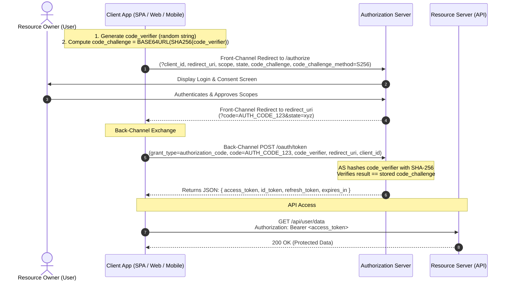

# Authentication & Authorization: From History to Modern Architecture

> **Authentication (AuthN)** = *Who are you?*
> **Authorization (AuthZ)** = *What are you allowed to do?*

These are two separate problems that get solved by two separate (but connected) systems. Almost every security bug in backend systems comes from conflating the two, so this doc keeps them apart throughout: first the identity problem (history → sessions → JWT → OAuth/OIDC), then the permissions problem (RBAC → ABAC → PBAC → ReBAC), then the practices that hold both together.

Each section follows the same pattern: **what problem existed → what was built to solve it → what new problem that created → what came next.** That chain is the actual story of this field — nothing was invented because it was "better," it was invented because the previous thing broke at some scale or in some new environment.

---

## Table of Contents

1. [A Brief History of Proving Who You Are](#1-a-brief-history-of-proving-who-you-are)
2. [Core Mechanisms: Sessions, Cookies, JWT](#2-core-mechanisms-sessions-cookies-jwt)
3. [Stateful vs Stateless Authentication](#3-stateful-vs-stateless-authentication)
4. [Delegation & Standardization: OAuth 2.0 and OIDC](#4-delegation--standardization-oauth-20-and-oidc)
5. [Choosing the Right Approach](#5-choosing-the-right-approach)
6. [Authorization Models: RBAC, ABAC, PBAC, ReBAC](#6-authorization-models-rbac-abac-pbac-rebac)
7. [Security Best Practices](#7-security-best-practices)
8. [Cheat Sheet](#8-cheat-sheet)

---

## 1. A Brief History of Proving Who You Are

### 1.1 Physical tokens (pre-computing)
Long before software, "authentication" meant a physical object or a shared secret: a seal, a key, a guard who recognized your face, a password spoken at a gate. The model was simple — possession or knowledge of a secret proved identity. This is the ancestor of two ideas still in use today: **something you have** (keys → hardware tokens → phones) and **something you know** (spoken password → typed password).

**Problem:** Doesn't scale past a small group of people who can personally vouch for each other, and secrets are easy to steal, copy, or coerce.

### 1.2 Mainframe passwords (1960s)
The first computer password system is usually credited to MIT's **CTSS (Compatible Time-Sharing System)**, ~1961, built to let multiple users share one mainframe without seeing each other's files. Each user got a password stored in a plaintext file on disk.

**Problem it solved:** Multi-tenancy on a single machine — the system needed *some* way to separate "your session" from "my session."
**New problem it created:** The password file itself became the target. In 1962, a researcher printed the plaintext password file to get more of his own allotted computer time — the first recorded password breach. Storing secrets in plaintext means *anyone* who reads the storage owns every identity in the system.

### 1.3 Hashing (1970s–1990s)
The fix: don't store the password, store a one-way function of it (a **hash**). On login, hash the input and compare to the stored hash. Even if the storage leaks, the raw password shouldn't be recoverable.

**Problem it solved:** Plaintext exposure on storage breach.
**New problem it created:** Early hashes (unsalted MD5/SHA1) are deterministic — the same password always produces the same hash. Attackers precompute huge lookup tables of hash → password (**rainbow tables**) and reverse the hash instantly for any common password.

### 1.4 Salting
Add a random, unique value (a **salt**) per user, hash `password + salt`, and store both the salt and the result. Now two users with the same password get different hashes, and a precomputed rainbow table is useless — the attacker would need one table *per salt*.

**Problem it solved:** Rainbow-table attacks at scale.
**New problem it created:** Salting doesn't slow down brute force — MD5/SHA are *designed to be fast*, which is exactly wrong for password storage. A modern GPU can compute billions of SHA-256 hashes per second, so short/common passwords still fall in minutes even when salted.

### 1.5 Deliberately slow hashing (bcrypt, scrypt, Argon2)
Purpose-built password hashing functions (`bcrypt` 1999, `scrypt` 2009, `Argon2` — winner of the 2015 Password Hashing Competition) are intentionally slow and/or memory-hard, with a tunable "cost factor" that you increase as hardware gets faster.

**Problem it solved:** Brute-force speed. Turns an attacker's billions-of-guesses-per-second into thousands or fewer.
**Remaining problem:** This only protects the *credential store*. It says nothing about how identity is carried across the many HTTP requests a user makes after logging in — HTTP itself has no concept of "the same user asked twice." That's the next problem, and it's a transport problem, not a storage problem.

### 1.6 Public Key Infrastructure (PKI) and asymmetric cryptography
In parallel, a different problem was being solved: **how do two parties who've never met establish trust over an insecure network?** Symmetric cryptography (one shared secret) requires the secret to already be shared safely — a chicken-and-egg problem at internet scale.

Asymmetric cryptography (Diffie–Hellman 1976, RSA 1977) solves this with **key pairs**: a public key anyone can see, and a private key only the owner holds. Data encrypted with the public key can only be decrypted with the private key (and vice versa for signatures). **PKI** is the system of Certificate Authorities (CAs) that vouch "this public key really belongs to this domain/entity," which is what makes HTTPS, TLS, and code signing work.

**Problem it solved:** Secure communication and identity verification between strangers, without a pre-shared secret.
**Why it matters for auth:** PKI underpins TLS (so passwords aren't sniffed in transit), and the same public/private key idea reappears later as the signing mechanism for JWTs and as the basis for passwordless authentication (WebAuthn/passkeys, client certificates).

This is the state of the art by the early 2000s: passwords are hashed properly at rest, transport is encrypted via TLS/PKI. What's left unsolved is: **once you've logged in once, how does the server remember you on request #2 without re-checking the password every time — and how does that work when "the server" is actually 50 servers behind a load balancer?**

---

## 2. Core Mechanisms: Sessions, Cookies, JWT

HTTP is **stateless by design** — each request is independent, with no memory of previous ones. Every "logged in" experience on the web is a workaround bolted onto a protocol that fundamentally doesn't have a concept of "session."

### 2.1 Sessions (the original workaround)

**How it works:**
1. User submits credentials.
2. Server verifies them, creates a **session record** (`session_id → { user_id, roles, expiry, ... }`) and stores it server-side (in memory, a database, or a fast store like Redis).
3. Server sends the client only the `session_id` — an opaque, random, meaningless string.
4. Client attaches that `session_id` on every subsequent request.
5. Server looks up the session record by ID on every request to know who's asking.

```text
POST /login {username, password}
  -> server verifies credentials
  -> server: sessions["sess_9f8a..."] = {userId: 42, expiresAt: ...}
  -> response: Set-Cookie: sid=sess_9f8a...

GET /profile
  Cookie: sid=sess_9f8a...
  -> server: record = sessions.get("sess_9f8a...")
  -> if record and not expired: proceed as user 42
  -> else: 401 Unauthorized
```

**Problem it solved:** Gave HTTP a concept of "the same user across requests," and — crucially — because the actual user data lives only on the server, **revocation is instant**: delete the session record and the user is logged out everywhere, immediately. This is still sessions' biggest advantage.

**New problem it created:**
- **Horizontal scaling:** if you have 10 backend servers behind a load balancer, server B needs to find a session created by server A. Fixes are either *sticky sessions* (route the same user to the same server — fragile, breaks on server restart) or a *shared session store* like Redis (extra infrastructure, extra network hop on every request, a new single point of failure).
- **Cross-domain / cross-service:** sessions are naturally tied to cookies, which are tied to a domain. This gets awkward fast for mobile apps, third-party APIs, and microservices talking to each other.

### 2.2 Cookies (the delivery mechanism)

Cookies aren't an authentication mechanism by themselves — they're the **browser's built-in transport** for attaching a small piece of data (like a session ID or a JWT) automatically to every request to a matching domain, without JavaScript having to do it manually.

Key attributes and the specific problem each one solves:

| Attribute | Problem it solves |
|---|---|
| `HttpOnly` | Blocks JavaScript from reading the cookie, so a cross-site scripting (XSS) bug on the page can't steal the token via `document.cookie`. |
| `Secure` | Cookie is only sent over HTTPS, so it can't be sniffed on plain HTTP. |
| `SameSite=Lax/Strict` | Cookie isn't automatically sent on cross-site requests, which is what makes Cross-Site Request Forgery (CSRF) attacks possible in the first place. |
| `Domain` / `Path` | Scopes exactly which requests the cookie is attached to. |

**Remaining problem:** Cookies are a *browser* concept. Native mobile apps, CLI tools, IoT devices, and server-to-server calls have no cookie jar, so anything cookie-based doesn't naturally extend outside the browser.

### 2.3 JWT — JSON Web Token (the stateless answer)

By the early 2010s, the industry was building distributed systems and public APIs at a scale where "every request does a database/Redis lookup just to know who's asking" was a real bottleneck, and where clients weren't always browsers. **JWT (RFC 7519, 2015)** is the answer: a **self-contained, cryptographically signed token** that carries the user's claims *inside itself*, so the server can verify it with pure computation — no storage lookup required.

**Structure:** `header.payload.signature`, each part base64url-encoded.

```text
header:  {"alg": "HS256", "typ": "JWT"}
payload: {"sub": "42", "role": "admin", "iat": 1735000000, "exp": 1735003600}
signature: HMACSHA256(base64url(header) + "." + base64url(payload), secretKey)

Final token:
eyJhbGciOiJIUzI1NiJ9.eyJzdWIiOiI0MiJ9.4f8a...  (one string, sent as Bearer token or cookie)
```

**Verification, server-side, no database call:**
```text
function verify(token, secretOrPublicKey):
    header, payload, signature = split(token, ".")
    expectedSig = sign(header + "." + payload, secretOrPublicKey)
    if signature != expectedSig:      # tampered or forged
        reject()
    if payload.exp < now():           # expired
        reject()
    return payload                     # trusted claims: user id, role, etc.
```

Two signing families, and why you'd pick each:
- **Symmetric (HS256):** one shared secret signs and verifies. Simple, but every service that needs to *verify* the token also has the power to *create* one — fine for a single backend, risky to hand out to many services.
- **Asymmetric (RS256 / ES256):** the auth server signs with a **private key**; any number of other services verify with the corresponding **public key**, which can be distributed freely without giving them signing power. This is what makes JWTs practical across microservices — this is literally the PKI idea from §1.6 reapplied to app-level tokens.

**Problem it solved:** Removes the server-side storage lookup and the shared-store bottleneck; any service holding the public key can independently verify a token, which fits microservices and distributed APIs naturally; works identically for browsers, mobile apps, and machine clients since it's just a string in a header.

**New problems it created:**
- **Revocation is hard.** A session can be deleted instantly. A JWT is valid until it expires, *no matter what* — there's no central "delete" because there's no central record. If a token is stolen, or a user is fired, or a role changes, the old token keeps working until it naturally expires.
- **Size.** A session ID is ~32 bytes. A JWT carrying several claims can be 500+ bytes, sent on *every single request*.
- **It's encoded, not encrypted.** Anyone can base64-decode the payload and read it (they just can't *forge* a valid signature for a modified one). Never put secrets (passwords, card numbers) in a JWT payload.
- **Payload can go stale.** If you baked `role: "user"` into the token at login and the admin promotes them mid-session, the token still says `"user"` until it's reissued.

**The common hybrid fix (used almost everywhere in practice):** short-lived **access token** (JWT, 5–15 minutes) + a longer-lived **refresh token** that *is* stored server-side (so it *can* be revoked). The access token's short life bounds the damage window; the refresh token gives you a revocation point without paying the DB-lookup cost on every request — only on the occasional refresh.

**Mini exercise:** Design the data your login endpoint returns for a "hybrid" scheme: what goes in the JWT payload, what goes in the refresh-token record, and what HTTP mechanism you'd use to deliver each to the client (header vs. cookie) and why.

---

## 3. Stateful vs Stateless Authentication

| | **Stateful (sessions)** | **Stateless (JWT)** |
|---|---|---|
| Where identity lives | Server-side store (DB/Redis) | Inside the token itself |
| Per-request cost | 1 storage lookup | Pure CPU (signature check) |
| Revocation | Instant — delete the record | Hard — must wait for expiry, or add a blocklist (which reintroduces state) |
| Horizontal scaling | Needs a shared store or sticky sessions | Naturally scales — any node with the public key can verify |
| Cross-domain / mobile / M2M | Awkward (cookie-bound) | Natural (just a header) |
| Token size | Small (opaque ID) | Larger (encodes claims) |
| Best fit | Traditional server-rendered web apps, admin panels — anywhere instant logout/revocation matters | Distributed APIs, microservices, mobile backends, anywhere you want to avoid a shared-state bottleneck |

**The real answer in production is rarely pure-either:** most serious systems run stateless JWTs for speed *and* keep one small piece of state — a refresh-token table or a short-TTL revocation blocklist — specifically to buy back revocation. That's the actual industry-standard architecture, not a purist stateless system.

---

## 4. Delegation & Standardization: OAuth 2.0 and OIDC

### 4.1 The Core Problem: The Password Anti-Pattern

In the late 2000s, web integrations were exploding. A classic example: **Yelp** wanted to find which of your friends were already on the platform. To do this, Yelp would ask you:
> *"Enter your Yahoo! or Google email and password so we can import your address book."*

This is the **Password Anti-Pattern** (or *credential sharing anti-pattern*). To give an application access to one specific slice of data (your contacts), you had to give that application full, unrestricted access to your entire account.

```text
[ User ] --- (Enters Google password directly into Yelp) ---> [ Yelp Backend ]
                                                                     |
                                                          (Logs into Google as User)
                                                                     v
                                                            [ Google Mail & Contacts ]
```

This caused four critical security flaws:
1. **Overprivileged Access:** Yelp didn't just get read access to your contacts; Yelp got the ability to read all your private emails, send emails as you, delete your account, or access your Google Drive.
2. **No Scoped or Granular Revocation:** If you wanted to stop Yelp from accessing your contacts, your *only* option was to change your Google password — which immediately broke every other integration you had ever set up.
3. **Third-Party Credential Compromise:** Unvetted third-party apps were storing millions of users' primary passwords in plaintext or poorly hashed databases. A breach at any minor startup compromised users across all their primary email and banking accounts.
4. **Zero Auditability:** From Google's perspective, every request made by Yelp looked identical to a request made by you. There was no cryptographic proof of who was actually acting.

The industry desperately needed **Delegated Authorization**: a way for a user to grant an application *scoped, time-limited, and revocable access* to their resources *without ever sharing their credentials with that application*.

---

### 4.2 OAuth 2.0 (RFC 6749) — Delegated, Scoped Access

Published in 2012, **OAuth 2.0** is an authorization framework designed specifically for token-based delegation.

#### The 4 Core Roles
OAuth 2.0 establishes four distinct entities:

```text
+-------------------+                    +-----------------------+
|  Resource Owner   |                    | Authorization Server  |
|     (The User)    |                    |  (e.g., auth.auth0.com|
+---------+---------+                    |   accounts.google.com)|
          |                              +-----------+-----------+
          |                                          |
          v                                          v
+---------+---------+                    +-----------+-----------+
|      Client       | -----------------> |    Resource Server    |
| (The Application) |    Access Token    | (API holding user data|
+-------------------+                    |  e.g., /api/contacts) |
                                         +-----------------------+
```

1. **Resource Owner (The User):** The entity capable of granting access to a protected resource (e.g., you, the owner of your photos or calendar).
2. **Client (The Third-Party Application):** The application requesting access to the user's data (e.g., Yelp, Spotify, a mobile app, or a web frontend).
3. **Authorization Server (AS):** The server that authenticates the user, obtains their consent, and issues security tokens to the client (e.g., `accounts.google.com`, Auth0, Okta, Keycloak).
4. **Resource Server (RS):** The API hosting the protected resources that accepts and validates access tokens (e.g., `google.com/calendar/v3`, `api.github.com`).

#### Core Token Types & Concepts
- **Access Token:** A credential representing the granted authorization. It is issued to the client and presented to the Resource Server in the `Authorization: Bearer <token>` header. Access tokens are short-lived (e.g., 5–60 minutes) and can be **opaque** (a random reference string that the RS validates via database or AS introspection) or **self-contained** (a signed JWT that the RS validates locally using public keys).
- **Refresh Token:** A long-lived, high-privilege credential issued to the client alongside the access token. It is used strictly between the client and the Authorization Server to obtain fresh access tokens when the current one expires, without prompting the user again.
- **Scope:** A string parameter defining the exact boundaries of permissions requested (e.g., `scope=contacts.readonly calendar.events.write`). The user can review and approve or deny individual scopes during consent.

#### Front-Channel vs. Back-Channel Architecture
Understanding OAuth requires separating the two communication channels:
- **Front-Channel (Untrusted, Browser-Mediated):** Uses HTTP redirects through the user's browser. It is inherently public, observable in browser history, visible to browser extensions, and vulnerable to interception. *Sensitive tokens should never be sent directly over the front-channel.*
- **Back-Channel (Trusted, Direct TLS):** A direct server-to-server HTTP request (`POST https://auth.example.com/oauth/token`) protected by TLS. It bypasses the browser completely and is immune to front-channel sniffing and tampering.

---

#### The Standard Flow: Authorization Code Grant with PKCE (RFC 7636)

The **Authorization Code Grant** is the gold standard for user delegation. In modern architecture, it is **always paired with PKCE (Proof Key for Code Exchange)**.

##### Why PKCE Was Created
Originally, the Authorization Code flow relied on a `client_secret` shared between the client backend and the Authorization Server. However:
- **Public Clients** (Single Page Apps in React/Vue, iOS/Android mobile apps, desktop apps) cannot securely store a `client_secret` — any user or attacker can decompile the app or inspect browser source code to extract the secret.
- **Authorization Code Interception Attacks:** On mobile operating systems or browsers, a malicious app could register a custom URL scheme (e.g., `myapp://callback`) and intercept the temporary `code` sent in the front-channel redirect. Without PKCE, the attacker could exchange that stolen code for access tokens.

PKCE solves this dynamically using asymmetric, one-time cryptographic proof generated per-request:



##### Step-by-Step Protocol Breakdown

**Step 1: Client generates PKCE parameters**
The client generates a high-entropy cryptographically random string (`code_verifier`) between 43 and 128 characters, and derives the `code_challenge`:
$$\text{code\_challenge} = \text{BASE64URL}(\text{SHA-256}(\text{code\_verifier}))$$

**Step 2: Authorization Request (Front-Channel)**
The client redirects the user's browser to the Authorization Server:
```http
GET /authorize?
  response_type=code
  &client_id=client_98765
  &redirect_uri=https%3A%2F%2Fmyapp.com%2Fcallback
  &scope=openid%20profile%20contacts.readonly
  &state=c2VjdXJlX3JhbmRvbV9zdGF0ZQ==
  &code_challenge=E9Melhoa2OwvFrGMTJguCH5...
  &code_challenge_method=S256 HTTP/1.1
Host: accounts.example.com
```

**Step 3: User Consent & Code Issuance (Front-Channel)**
The user logs in at the AS and grants permission. The AS redirects the browser back to the `redirect_uri` with a short-lived (e.g., 30–60 second) single-use authorization code:
```http
HTTP/1.1 302 Found
Location: https://myapp.com/callback?code=SplxlOBeZQQYbYS6WxSbIA&state=c2VjdXJlX3JhbmRvbV9zdGF0ZQ==
```

**Step 4: Token Exchange (Back-Channel)**
The client sends a direct HTTPS `POST` request to the token endpoint, presenting the `code` and the original `code_verifier`:
```http
POST /oauth/token HTTP/1.1
Host: accounts.example.com
Content-Type: application/x-www-form-urlencoded

grant_type=authorization_code
&client_id=client_98765
&code=SplxlOBeZQQYbYS6WxSbIA
&redirect_uri=https%3A%2F%2Fmyapp.com%2Fcallback
&code_verifier=dBjftJeZ4CVP-mB92K27uhbUJU1p1r_wW1gFWFOEjXk
```
The Authorization Server computes `SHA256(code_verifier)`. If it matches the `code_challenge` sent in Step 2, it issues tokens:
```json
HTTP/1.1 200 OK
Content-Type: application/json;charset=UTF-8

{
  "access_token": "eyJhbGciOiJSUzI1NiIs...",
  "token_type": "Bearer",
  "expires_in": 3600,
  "refresh_token": "rF489xKa91Z...",
  "scope": "contacts.readonly"
}
```

> [!TIP]
> **Why PKCE is mandatory for all clients today (OAuth 2.1):** Even if an attacker steals the `code` via browser history or custom URL sniffing, they cannot exchange it at `/oauth/token` because they do not have the raw `code_verifier` stored in the legitimate client's memory.

---

#### Other OAuth 2.0 Grant Types

| Grant Type | When to Use | How it Works |
|---|---|---|
| **Client Credentials** | Machine-to-Machine (M2M), cron jobs, backend daemons | Client sends `client_id` + `client_secret` directly to `/token`. There is no user, browser, or consent screen involved. The token represents the service itself. |
| **Refresh Token Grant** | Renewing expired access tokens | Client sends `POST /token` with `grant_type=refresh_token&refresh_token=...`. AS responds with a new access token (and optionally a rotated refresh token). |
| **Device Authorization (RFC 8628)** | Input-constrained devices (Smart TVs, CLI tools, IoT) | Device displays a short user code and URL (e.g., `google.com/device`). User navigates to the URL on their phone/laptop to approve while the device polls `/token`. |
| **Implicit Grant (DEPRECATED)** | *Formerly* SPAs | Tokens were returned directly in the front-channel URL hash (`#access_token=...`). **Forbidden in modern security** due to token leakage in browser history and referrer headers. Replaced by Auth Code + PKCE. |
| **Resource Owner Password (DEPRECATED)** | *Legacy* migrations | User gave username/password directly to the client. Defeated the entire purpose of OAuth. Completely removed in OAuth 2.1. |

---

### 4.3 The Identity Trap & OpenID Connect (OIDC - 2014)

#### The Problem: OAuth 2.0 is NOT Authentication
Because OAuth 2.0 ends with the user logging into an Authorization Server and returning tokens, developers in the early 2010s started using OAuth 2.0 as a login mechanism ("Sign in with Facebook / Google").

This caused a serious security flaw known as the **Pseudo-Authentication / Confused Deputy Trap**:
1. An access token is an authorization credential for a specific API, **not proof of identity for a client application**.
2. **Token Substitution Attack:** Suppose you log into MaliciousApp using your Google account. MaliciousApp obtains a valid Google access token for its own app. MaliciousApp then takes that access token and sends it to VictimApp's login endpoint. VictimApp calls Google's API with the token, gets your user profile back, and says "Oh, Google says this is Alice! Logging in Alice." 
3. Because standard OAuth access tokens did not specify the intended *audience* (the relying client app), VictimApp could not tell that the token was generated for MaliciousApp, allowing an attacker to impersonate any user.
4. Furthermore, there was no standardized format for user IDs, profile data, or token verification. Every provider invented proprietary endpoints (e.g., Facebook Graph API, Google UserInfo, GitHub `/user`).

#### OpenID Connect (OIDC): Identity Standardized on Top of OAuth 2.0
**OIDC (2014)** is an identity and authentication protocol built as a strict, standard layer on top of OAuth 2.0. 

```text
+-------------------------------------------------------------+
|               OpenID Connect (OIDC) (AuthN)                 |
|   - ID Token (JWT)          - Discovery (/.well-known)      |
|   - Standard Claims         - UserInfo Endpoint (/userinfo) |
+-------------------------------------------------------------+
|                      OAuth 2.0 (AuthZ)                      |
|   - Authorization Code + PKCE       - Scopes                |
|   - Access Tokens & Refresh Tokens  - Client Credentials    |
+-------------------------------------------------------------+
|                      HTTP / TLS / TCP                       |
+-------------------------------------------------------------+
```

When a client requests the standard scope `scope=openid`, the Authorization Server acts as an **OpenID Provider (OP)** and returns an **ID Token** in addition to the access token.

#### The ID Token (JWT) Anatomy
An ID Token is always a cryptographically signed JSON Web Token (JWT) asserting that the user was authenticated. It contains standardized **claims**:

```json
// Decoded ID Token Payload:
{
  "iss": "https://accounts.google.com",         // Issuer: Who created this token
  "sub": "1098234098123049812",                 // Subject: Unique, permanent user ID
  "aud": "my-client-app-id-98765",              // Audience: MUST match YOUR client_id
  "exp": 1735003600,                            // Expiration timestamp (Unix epoch)
  "iat": 1735000000,                            // Issued-at timestamp
  "auth_time": 1734999990,                      // Time when user actually entered credentials
  "nonce": "n-0S6_WzA2Mj",                      // Cryptographic nonce passed in /authorize
  "email": "alice@example.com",                 // Standardized profile claim
  "email_verified": true,
  "name": "Alice Smith"
}
```

#### Access Token vs. ID Token: The Cardinal Rule

| Dimension | Access Token | ID Token |
|---|---|---|
| **Primary Purpose** | **Authorization:** Granting permission to access an API | **Authentication:** Proving identity to the client app |
| **Intended Audience (`aud`)** | The **Resource Server (API)** (e.g., `https://api.myapp.com`) | The **Client Application** (e.g., `my-client-app-id`) |
| **Should Client Inspect?** | **No.** Client should treat it as an opaque bearer string. | **Yes.** Client *must* decode and validate its claims. |
| **Format** | Opaque string or JWT (internal to AS and RS) | **Always a signed JWT** formatted to OIDC spec |
| **Where to Send** | Sent in `Authorization: Bearer` to Resource Server | Kept by client to establish local app session |

> [!CAUTION]
> **Never accept an Access Token as proof of identity, and never send an ID Token to an API as an authorization credential.** Mixing them up breaks the audience boundary and re-opens token substitution vulnerabilities.

---

#### The 3 Pillars of OIDC Standardization

##### 1. Discovery Document (`/.well-known/openid-configuration`)
OIDC allows any client to automatically configure itself by fetching a standard JSON document from the provider's domain:
```http
GET https://accounts.google.com/.well-known/openid-configuration
```
This document exposes all dynamic endpoints:
- `authorization_endpoint`: URL for login/consent.
- `token_endpoint`: URL for code exchange.
- `jwks_uri`: URL where public keys are published.
- `userinfo_endpoint`: URL to fetch additional profile attributes.
- `response_types_supported`, `id_token_signing_alg_values_supported`, etc.

##### 2. JSON Web Key Set (JWKS) & Key Rotation (`/.well-known/jwks.json`)
The OpenID Provider signs ID tokens (and often JWT access tokens) using its private asymmetric key (RSA or ECDSA). The provider publishes the public keys at the `jwks_uri`:

```json
{
  "keys": [
    {
      "kty": "RSA",
      "use": "sig",
      "alg": "RS256",
      "kid": "key_2026_09",
      "n": "u1P...[base64 RSA modulus]...",
      "e": "AQAB"
    }
  ]
}
```
- When validating a token, the client checks the JWT header: `{"alg": "RS256", "kid": "key_2026_09"}`.
- It matches `kid` (Key ID) against the cached JWKS to find the matching public key and verifies the digital signature without any shared secrets or database lookups.
- **Key Rotation:** When the provider rotates its signing keys, it adds the new key to the JWKS with a new `kid`. Clients automatically fetch the updated JWKS on cache-miss, enabling zero-downtime key rotation.

##### 3. Standardized UserInfo Endpoint (`/userinfo`)
A protected OAuth 2.0 resource where the client presents the access token to retrieve extra profile data (e.g., picture, address, phone number) when those claims were not packed into the ID token.

---

### 4.4 How to Implement: Production Architecture & Code

Let's look at how to implement an end-to-end OIDC + OAuth 2.0 flow securely using modern backend patterns (TypeScript / Node.js with the standard [`jose`](https://github.com/panva/jose) library for zero-dependency cryptographic JWT/JWKS handling).

#### 1. Generating Auth Request with PKCE (Frontend / Client Backend)

```typescript
import crypto from "crypto";

// Helper: Generate base64url-encoded random string
function base64URLEncode(buffer: Buffer): string {
  return buffer.toString("base64")
    .replace(/\+/g, "-")
    .replace(/\//g, "_")
    .replace(/=+$/, "");
}

// 1. Generate high-entropy PKCE code_verifier (32 random bytes)
export function generateCodeVerifier(): string {
  return base64URLEncode(crypto.randomBytes(32));
}

// 2. Generate code_challenge = SHA256(code_verifier)
export function generateCodeChallenge(verifier: string): string {
  const hash = crypto.createHash("sha256").update(verifier).digest();
  return base64URLEncode(hash);
}

// 3. Construct Authorization URL
export function buildAuthorizationUrl(config: {
  authEndpoint: string;
  clientId: string;
  redirectUri: string;
  scope: string;
  state: string;
  nonce: string;
  codeChallenge: string;
}): string {
  const params = new URLSearchParams({
    response_type: "code",
    client_id: config.clientId,
    redirect_uri: config.redirectUri,
    scope: config.scope, // e.g. "openid profile email api:read"
    state: config.state, // CSRF protection
    nonce: config.nonce, // Replay protection
    code_challenge: config.codeChallenge,
    code_challenge_method: "S256",
  });

  return `${config.authEndpoint}?${params.toString()}`;
}
```

#### 2. Handling Callback & Token Exchange (Client Backend)

```typescript
import axios from "axios";

export async function handleOAuthCallback(params: {
  code: string;
  state: string;
  expectedState: string;
  codeVerifier: string;
  tokenEndpoint: string;
  clientId: string;
  clientSecret?: string; // Optional if public client with PKCE
  redirectUri: string;
}) {
  // 1. Validate State to prevent Login CSRF attacks
  if (params.state !== params.expectedState) {
    throw new Error("Invalid state parameter. Possible CSRF attack.");
  }

  // 2. Exchange Authorization Code + code_verifier for tokens (Back-Channel)
  const body = new URLSearchParams({
    grant_type: "authorization_code",
    client_id: params.clientId,
    code: params.code,
    redirect_uri: params.redirectUri,
    code_verifier: params.codeVerifier,
  });

  if (params.clientSecret) {
    body.append("client_secret", params.clientSecret);
  }

  const response = await axios.post(params.tokenEndpoint, body.toString(), {
    headers: { "Content-Type": "application/x-www-form-urlencoded" },
  });

  const { id_token, access_token, refresh_token, expires_in } = response.data;
  return { idToken: id_token, accessToken: access_token, refreshToken: refresh_token, expiresIn: expires_in };
}
```

#### 3. Cryptographically Validating the ID Token using JWKS (Client Backend)

```typescript
import * as jose from "jose";

export async function verifyIdToken(idToken: string, config: {
  jwksUri: string;
  expectedIssuer: string;
  expectedClientId: string;
  expectedNonce: string;
}) {
  // 1. Set up JWKS remote key set resolver with automated caching and key rotation
  const JWKS = jose.createRemoteJWKSet(new URL(config.jwksUri));

  // 2. Verify signature, issuer, audience, and expiration in one cryptographic step
  const { payload } = await jose.jwtVerify(idToken, JWKS, {
    issuer: config.expectedIssuer,
    audience: config.expectedClientId, // Crucial: ensures token was issued FOR THIS APP
  });

  // 3. Verify Nonce to prevent Token Replay attacks
  if (payload.nonce !== config.expectedNonce) {
    throw new Error("Nonce mismatch. Possible replay attack.");
  }

  return {
    userId: payload.sub,
    email: payload.email as string,
    name: payload.name as string,
  };
}
```

#### 4. Protecting API Routes with JWT Access Token Verification (Resource Server Middleware)

```typescript
import { Request, Response, NextFunction } from "express";
import * as jose from "jose";

export function createAuthMiddleware(config: {
  jwksUri: string;
  expectedIssuer: string;
  expectedAudience: string; // The API identifier (e.g. "https://api.mycompany.com")
}) {
  const JWKS = jose.createRemoteJWKSet(new URL(config.jwksUri));

  return async (req: Request, res: Response, next: NextFunction) => {
    const authHeader = req.headers.authorization;
    if (!authHeader?.startsWith("Bearer ")) {
      return res.status(401).json({ error: "Missing or malformed Authorization header" });
    }

    const token = authHeader.split(" ")[1];

    try {
      // Validate signature against AS public keys and check API audience
      const { payload } = await jose.jwtVerify(token, JWKS, {
        issuer: config.expectedIssuer,
        audience: config.expectedAudience,
      });

      // Attach authenticated claims and scopes to the request context
      (req as any).user = {
        id: payload.sub,
        scopes: typeof payload.scope === "string" ? payload.scope.split(" ") : [],
      };

      next();
    } catch (err: any) {
      return res.status(401).json({ error: "Invalid or expired token", details: err.message });
    }
  };
}
```

---

### 4.5 Security Pitfalls & Defense-in-Depth Checklist

| Vulnerability | Attack Mechanism | Required Defense |
|---|---|---|
| **Login CSRF** | Attacker starts OAuth flow, intercepts code, tricks victim's browser into completing the callback with attacker's code, binding victim's session to attacker's account. | **Cryptographic `state` parameter:** Store a cryptographically random, signed, or session-bound value in an `HttpOnly` cookie before redirect and verify it matches the `state` query param on callback. |
| **Token Replay Attack** | Attacker intercepts a valid ID Token and repeatedly submits it to authenticate. | **`nonce` claim:** Include a client-generated random nonce in `/authorize`. Verify the ID Token payload contains the exact identical `nonce`. |
| **Code Interception** | Malicious app intercepts front-channel redirect authorization code on mobile OS or browser. | **PKCE (`code_verifier` / `code_challenge`):** Always require S256 PKCE on all clients. |
| **Open Redirect / URI Poisoning** | Attacker passes `redirect_uri=https://evil.com` to `/authorize` to steal authorization codes. | **Strict Exact-String Matching:** The Authorization Server MUST strictly validate `redirect_uri` against pre-registered exact URIs. Never allow wildcards (`*`) or regex matches in redirect URIs. |
| **Token Storage Leakage** | Storing refresh tokens or access tokens in browser `localStorage` where they are vulnerable to XSS theft. | **Backend-for-Frontend (BFF) Pattern:** Store tokens inside server-side sessions or encrypted `HttpOnly`, `Secure`, `SameSite=Lax` cookies. |


---

## 5. Choosing the Right Approach

| Scenario | Recommended approach | Why |
|---|---|---|
| Traditional server-rendered web app, single backend | **Sessions** | Instant revocation matters, and you don't have a distributed-lookup problem to solve. |
| Distributed APIs / microservices / mobile backend | **Stateless JWT** (+ refresh token) | No shared-store bottleneck; any service can verify independently with the public key. |
| Letting a third-party app act on a user's behalf | **OAuth 2.0** (+ OIDC if you need identity, not just access) | Scoped, revocable, no credential sharing. |
| Service-to-service / machine-to-machine, no user involved | **API keys** or **OAuth Client Credentials** or **mTLS** | There's no "user" to redirect through a login screen; you need a long-lived or automatically-renewed machine identity instead. |

A pragmatic rule of thumb: **default to sessions until you have an actual, measured reason to go stateless** (multiple services needing independent verification, mobile/native clients, or a genuinely large horizontal-scaling need). Statelessness trades away your easiest revocation story, so it should be a deliberate trade, not a default.

---

## 6. Authorization Models: RBAC, ABAC, PBAC, ReBAC

Authentication tells you *who* is calling. Authorization decides, on every single request, whether *that person* can do *this specific thing* to *this specific resource*. This is where most production security bugs actually live — not in the login form, but in a missing check on some endpoint deep in the app ("Insecure Direct Object Reference" — user A requests resource ID belonging to user B, and the backend never checks ownership).

The four models below aren't strict generations replacing each other — they're points on a spectrum from *simple and coarse* to *flexible and fine-grained*, and real systems often combine two of them.

### 6.1 RBAC — Role-Based Access Control

**Idea:** Permissions attach to **roles**, not directly to users. Users get one or more roles.

```text
roles = {
  "admin": ["read:*", "write:*", "delete:*"],
  "editor": ["read:posts", "write:posts"],
  "viewer": ["read:posts"]
}
users = {
  "user_42": ["editor"]
}

function can(userId, action):
    for role in users[userId]:
        if action in roles[role]:
            return true
    return false

# check before a request executes:
if not can("user_42", "delete:posts"):
    return 403 Forbidden
```

**Problem it solved:** Before RBAC, permissions were often assigned per-user directly — fine for 10 users, unmanageable for 10,000. RBAC means onboarding someone is "assign a role," not "individually configure 40 permission flags."

**Problem it doesn't solve (why the next models exist):** RBAC has no concept of *context*. It can express "editors can edit posts," but not "editors can edit *their own* posts, but not someone else's" — that distinction needs to look at a relationship between the user and the specific resource, which a static role can't encode. Teams solve this by creating more and more granular roles (`editor-own-posts-only`), which leads to **role explosion**: hundreds of near-duplicate roles that are hard to audit.

**Assignment:** Extend the pseudocode above so `editor` can edit a post only if `post.authorId == userId`. Notice you can't express this with roles alone — you need to look at the *resource*, which is exactly what §6.2 formalizes.

### 6.2 ABAC — Attribute-Based Access Control

**Idea:** Decisions are computed from **attributes** of the user, the resource, the action, and the environment — evaluated at request time, not looked up from a static table.

```text
function can(user, resource, action, env):
    if action == "edit" and resource.type == "post":
        return user.id == resource.authorId
               and resource.status != "locked"
               and env.time.hour between 6 and 22   # e.g., no off-hours edits
    if action == "view" and resource.type == "report":
        return user.department == resource.department
               or user.clearanceLevel >= resource.sensitivityLevel
    return false
```

**Problem it solved:** Dynamic, contextual decisions RBAC structurally can't express — ownership, time of day, IP range, resource sensitivity, department match, device trust level, anything computable at request time.

**New problem it created:** Logic like this scattered across application code becomes very hard to audit ("what are *all* the ways someone can access a sensitive report?" now requires reading code, not reading a table) and hard to reuse consistently across services — every team reimplements similar attribute checks slightly differently.

**Assignment:** Write the attribute rule for "a support agent can view a customer's ticket only if the ticket is assigned to their team AND was created in the last 90 days." Identify which attributes belong to the user, which to the resource, and which to the environment.

### 6.3 PBAC — Policy-Based Access Control

**Idea:** Take the ABAC logic *out* of scattered application code and centralize it as **declarative policy**, evaluated by a dedicated policy engine that every service calls. The most common real implementation of this idea is **OPA (Open Policy Agent)** with its policy language **Rego**, or AWS IAM policies as another familiar example.

```text
# policy (language-agnostic pseudocode of a Rego-style rule)
policy "edit_post":
    allow if:
        request.action == "edit"
        request.resource.type == "post"
        request.user.id == request.resource.authorId
        request.resource.status != "locked"

# application code becomes a single, uniform call:
decision = policyEngine.evaluate(policy="edit_post", request=currentRequest)
if not decision.allow:
    return 403 Forbidden
```

**Problem it solved:** Decouples "what's the rule" from "where's the code that runs it" — policies become versioned, testable, centrally auditable artifacts instead of `if` statements buried across a codebase. Multiple services enforce the *same* policy by calling the *same* engine instead of each re-implementing the logic.

**New problem it created:** Now you have a new critical-path dependency (the policy engine) that every authorization check calls — its latency and availability directly become your API's latency and availability, and you've added an entirely new domain-specific language (Rego, Cedar, etc.) for the team to learn.

**Assignment:** Take the ABAC rule you wrote in §6.2's exercise and rewrite it as a standalone policy definition, separate from any specific programming language — then describe, in one sentence, what your API code would send to the policy engine and what it would get back.

### 6.4 ReBAC — Relationship-Based Access Control

**Idea:** Permissions are derived from a **graph of relationships** between entities, not from roles or static attributes. "Can user X view document Y?" becomes a graph-reachability question: is there a path from X to Y through relationships like `owner`, `editor`, `member-of`, `parent-folder`? This is the model behind **Google's Zanzibar** paper (2019, the system behind Drive/Docs sharing permissions) and open-source implementations like **SpiceDB** and **Ory Keto**.

```text
# relationship tuples, e.g.:
(user:42,   "owner",  document:100)
(user:43,   "editor", document:100)
(group:eng, "viewer", document:100)
(user:44,   "member", group:eng)

function can(user, action, resource):
    if action == "view":
        return hasRelation(user, ["owner","editor","viewer"], resource)
                or existsGroup g where hasRelation(g, "viewer", resource)
                                    and hasRelation(user, "member", g)
    if action == "edit":
        return hasRelation(user, ["owner","editor"], resource)
```

This is exactly how "share this folder with the Engineering group, and anyone in that group can see every file inside it, including subfolders" works in real products — it's relationships composed through a graph, not a role or a static attribute rule.

**Problem it solved:** ABAC/PBAC struggle to express *inherited, nested, and transitive* access naturally (a file inside a folder inside a shared drive; a group that's a member of another group). ReBAC models this as first-class graph traversal, which is a much more natural fit and — in systems like Zanzibar — can be made consistently fast at massive scale.

**New problem it introduces:** You need a graph store and a traversal engine (not just a rules table), consistency guarantees become genuinely tricky at scale (Zanzibar's paper spends significant effort on exactly this — making sure a permission change is visible everywhere before a subsequent read, without every read paying a huge latency cost), and reasoning about "who can see this" for an audit can require walking a large graph rather than reading one row.

**Assignment:** Model a simple "shared folders" feature as relationship tuples: a user owns a folder, invites another user as an editor, and a whole team gets viewer access. Write out the tuples, then write the `can(user, "view", file)` check assuming the file inherits its folder's permissions.

### 6.5 Putting it together
Most real systems don't pick exactly one. A common pragmatic combination: **RBAC for coarse gates** ("is this user even an employee vs. a customer, is this account on the right subscription tier") layered with **ReBAC or ABAC for resource-level, ownership-aware decisions** ("can this specific employee edit this specific document"), often implemented through a **PBAC-style centralized engine** so the rules are auditable in one place instead of scattered across services.

---

## 7. Security Best Practices

### 7.1 Don't leak information through error messages
A login form that says "no account with that email" vs. "incorrect password" tells an attacker which emails are registered — an **enumeration attack**. Always return the same generic message and the same timing profile for both cases:

```text
# BAD
if not userExists(email): return "No account found"
if not passwordMatches(email, password): return "Incorrect password"

# GOOD — identical response either way
if not userExists(email) or not passwordMatches(email, password):
    return "Invalid email or password"
```

The same principle applies past login: a `404` for "resource doesn't exist" and a `404` for "resource exists but you're not authorized to see it" should usually look identical from the outside — returning `403` instead of `404` can itself leak that the resource exists.

### 7.2 Timing attacks and constant-time comparison
A naive string comparison (`a == b`) typically returns as soon as it hits the first mismatched character — which means comparing a *closer* guess takes measurably longer than comparing a wildly wrong one. Over many requests, an attacker can use that timing difference to guess a secret (like an API key or token) one character at a time.

The fix is a **constant-time comparison** function that always takes the same amount of time regardless of where — or whether — a mismatch occurs, usually by comparing every byte and combining the result with a bitwise OR/XOR instead of returning early:

```text
function constantTimeEquals(a, b):
    if length(a) != length(b):
        return false          # length itself should also not leak timing where possible
    result = 0
    for i in 0..length(a):
        result = result OR (byteAt(a, i) XOR byteAt(b, i))
    return result == 0
```

Nearly every mainstream language/standard library ships one of these already (e.g. `crypto/subtle.ConstantTimeCompare` in Go, `hmac.compare_digest` in Python, `crypto.timingSafeEqual` in Node) — the point isn't to hand-roll it, it's to know *when* you need it: comparing secrets (tokens, HMAC signatures, API keys), never comparing regular non-secret data.

### 7.3 Other practices worth naming
- **Rate limit and lock out** login and token-refresh endpoints to blunt brute-force and credential-stuffing attacks.
- **Short-lived access tokens + revocable refresh tokens** (the hybrid from §2.3) so a leaked access token has a small blast radius.
- **Never store JWTs in `localStorage`** for anything security-sensitive — it's readable by any JavaScript on the page, so an XSS bug becomes full account takeover. Prefer an `HttpOnly` cookie.
- **Rotate signing keys** periodically and support key rotation without downtime (this is what the `kid` header field in a JWT and the discovery document in OIDC are for).
- **MFA** (a second, independent factor — TOTP, WebAuthn/passkeys) so a leaked password alone isn't enough.
- **Principle of least privilege** at every authorization layer above — grant the narrowest scope/role/relationship that gets the job done, not the broadest one that's convenient.

---

## 8. Cheat Sheet

| Need | Reach for |
|---|---|
| Traditional web app, need instant logout | Sessions |
| Distributed system, many services verifying tokens | JWT (short-lived) + server-side refresh token |
| Let a third-party app access user data | OAuth 2.0 |
| "Sign in with Google/GitHub/etc." | OIDC (built on OAuth 2.0) |
| Machine-to-machine, no human user | API key / OAuth Client Credentials / mTLS |
| Simple, small permission set (admin/editor/viewer) | RBAC |
| Permissions depend on context (ownership, time, department) | ABAC |
| Need one auditable, centrally-enforced rule set across services | PBAC (e.g. OPA/Rego) |
| Sharing/nested/graph-like permissions (folders, groups, teams) | ReBAC (e.g. Zanzibar-style) |
| Comparing any secret value | Constant-time comparison, always |
