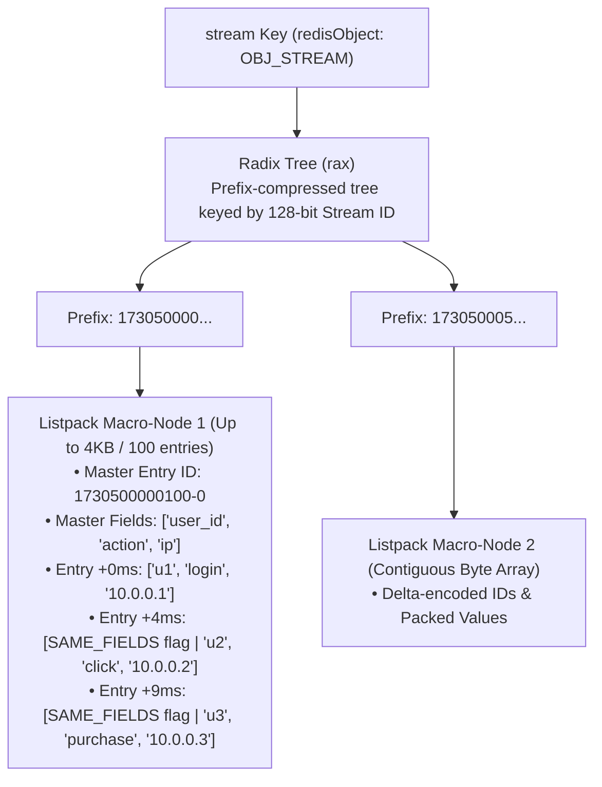

# Phase 1 Manual: CLI Fundamentals & Internal Mechanics (Pub/Sub, Streams, HyperLogLog, Bitmaps & Geo)

This manual guides you through the internal C data structures, memory encodings, algorithmic complexities, and CLI operations for Redis's four most powerful non-caching subsystems: **Pub/Sub (and Sharded Pub/Sub), Redis Streams (`rax` + `listpack`), Probabilistic HyperLogLog (`HYLL`), and Bitmaps / Bitfields / Geospatial ZSETs**.

---

## Prerequisites

Ensure your cluster is running and Keyspace Notifications are enabled:
```bash
docker compose -f cache/docker-compose.yml up -d
docker exec -it redis-master redis-cli CONFIG SET notify-keyspace-events ExKEA
```

---

## Day 1: Redis Pub/Sub Internals & Real-Time Fan-Out

### 1. Internal C Data Structures: How Redis Routes Messages in $O(1)$ and $O(P)$

Unlike Redis keys, **Pub/Sub channels do not exist in the keyspace dictionary (`db->dict`)**. They have no TTL, consume zero memory when no clients are subscribed, and are stored inside two global server fields inside `struct redisServer`:

```
struct redisServer {
    dict *pubsub_channels;        // Hash Table: Channel Name (SDS) ──► Linked List of *client
    list *pubsub_patterns;        // Doubly-Linked List of pubsubPattern structs (glob patterns)
    dict *pubsubshard_channels;   // Redis 7.0+: Slot-pinned Sharded Channels
};
```

```
1. Exact Channel Lookup: server.pubsub_channels (O(1) Hash Lookup + O(N_subscribers) Fan-Out)
┌────────────────────────┐
│ "orders:us-east" (SDS) │ ──► [ *client_A ] ◄──► [ *client_B ] ◄──► [ *client_C ]
├────────────────────────┤
│ "chat:room:42"   (SDS) │ ──► [ *client_D ]
└────────────────────────┘

2. Pattern Matching Lookup: server.pubsub_patterns (O(P_patterns) Linear Glob Scan on EVERY PUBLISH!)
┌────────────────────────────────────────┐      ┌────────────────────────────────────────┐
│ pattern: "orders:*" | client: *client_X │ ───► │ pattern: "chat:*"   | client: *client_Y │
└────────────────────────────────────────┘      └────────────────────────────────────────┘
```

#### Time Complexity & Performance Trap:
When a client runs `PUBLISH orders:us-east "payload"`:
1. Redis hashes `"orders:us-east"` in `server.pubsub_channels` in **$O(1)$ time** and writes the message into the socket output buffer of every subscribed client ($O(N_{\text{subscribers}})$).
2. Next, Redis iterates through **every registered pattern** in `server.pubsub_patterns` and runs `stringmatchlen()` (glob matching).
3. **Production Hazard:** If 50,000 microservice clients register distinct `PSUBSCRIBE` glob patterns, **every single `PUBLISH` command executes 50,000 string glob comparisons on the single Redis thread!** Prefer exact `SUBSCRIBE` or `SSUBSCRIBE` channels at scale.

---

### 2. Delivery Guarantees: Why Pub/Sub is `At-Most-Once` (Fire-and-Forget)

```
Publisher ──(PUBLISH ch "msg")──► Redis Server ──► Writes directly to active TCP Socket Buffers
                                       │
                        [Client D is disconnected for 50ms]
                                       │
                                       ▼
                        Message is permanently lost for Client D!
                        (No disk log, no offset, no retry queue)
```

- **Return value of `PUBLISH`:** Returns an integer representing the number of subscribers that received the message in their output buffer at that instant. If `0`, the message was immediately discarded into the void.

---

### 3. Redis 7.0+ Sharded Pub/Sub (`SPUBLISH` / `SSUBSCRIBE`)

In standard Redis Cluster, `PUBLISH` is a **cluster-wide broadcast**: if you publish a message to Node 1 in a 100-node cluster, Node 1 forwards a copy of that message to **all 99 other nodes** over the cluster bus, saturating network bandwidth.

**Redis 7.0 introduced Sharded Pub/Sub:**
- Channels are hashed using the exact same `CRC16(channel) % 16384` algorithm as Redis keys.
- `SSUBSCRIBE` and `SPUBLISH` route only to the node owning that channel's hash slot.
- Messages are replicated only within that shard's master-replica group—eliminating $O(N_{\text{nodes}})$ cluster bus amplification!

---

### 4. Hands-On CLI Lab: Pub/Sub, Pattern Subscriptions & Introspection

Open **3 terminal windows** connected to `redis-master`:

**Terminal 1 (Exact & Pattern Subscriber):**
```bash
docker exec -it redis-master redis-cli
```
```redis
SUBSCRIBE payment:success
```

**Terminal 2 (Wildcard Pattern & Sharded Subscriber):**
```bash
docker exec -it redis-master redis-cli
```
```redis
PSUBSCRIBE payment:*
```

**Terminal 3 (Publisher & Introspection Inspector):**
```bash
docker exec -it redis-master redis-cli
```
```redis
# 1. List all active channels with >= 1 exact subscriber
PUBSUB CHANNELS *
# 1) "payment:success"

# 2. Check subscriber count for specific channels
PUBSUB NUMSUB payment:success payment:failed
# 1) "payment:success"
# 2) (integer) 1
# 3) "payment:failed"
# 4) (integer) 0

# 3. Check total active pattern subscriptions across the server
PUBSUB NUMPAT
# (integer) 1

# 4. Publish an event and see how many clients receive it
PUBLISH payment:success "{\"order_id\": 501, \"amount\": 99.95}"
# (integer) 2   <-- Delivered to BOTH Terminal 1 (SUBSCRIBE) and Terminal 2 (PSUBSCRIBE)!

PUBLISH payment:failed "{\"order_id\": 502, \"reason\": \"insufficient_funds\"}"
# (integer) 1   <-- Delivered ONLY to Terminal 2 (PSUBSCRIBE payment:*)

# 5. Inspect Pub/Sub client output buffers (check 'oll' and 'omem' fields)
CLIENT LIST TYPE pubsub
```

---

## Day 2: Redis Streams Internals & Consumer Groups (`XADD` to `XAUTOCLAIM`)

Introduced in Redis 5.0 and significantly enhanced in Redis 6.2 and 7.0, **Redis Streams** is an append-only, persistent, partitioned log data structure modeled after Apache Kafka—built directly into Redis RAM.

---

### 1. Physical Memory Layout: The Radix Tree (`rax`) + `listpack` Macro-Node

If Redis stored every stream event as a separate C struct with pointers, 10 million log events would waste gigabytes on pointer headers. Instead, Salvatore Sanfilippo designed a custom **Compressed Radix Tree (`rax`)** where each leaf points to a **`listpack` macro-node**:



#### Why `rax` + `listpack` is Extraordinarily Fast & Compact:
1. **Field-Name Deduplication (`SAME_FIELDS`):** Almost all entries in a stream share the same schema (e.g., `order_id`, `user_id`, `amount`). The `listpack` stores the field names **only once in the header** of the macro-node! Subsequent entries set a 1-bit `LP_STREAM_ITEM_FLAG_SAMEFIELDS` flag and write **only the raw values**.
2. **Delta-Encoded Timestamps:** Instead of storing a full 128-bit ID (`64-bit ms + 64-bit seq`) for every message, entries inside a `listpack` store only the tiny varint difference ($\Delta\text{ms}, \Delta\text{seq}$) relative to the macro-node's master ID.
3. **Configurable Macro-Node Tuning:** Controlled via `stream-node-max-bytes 4096` (4KB) and `stream-node-max-entries 100`.

---

### 2. Stream Entry IDs & Consumer Group Architecture

Every entry ID is a monotonically increasing 128-bit pair:
$$\underbrace{\text{1730500000125}}_{\text{64-bit Unix Milliseconds}} - \underbrace{\text{0}}_{\text{64-bit Sequence Counter within that ms}}$$

- **Clock Skew Protection:** If the system NTP clock jumps backward by 50ms, Redis refuses to decrease the timestamp. Instead, it keeps the `last_generated_id` millisecond value and increments the sequence number (`-1`, `-2`, `-3`) until wall-clock time catches up!

#### Consumer Group State Machine & The PEL (Pending Entries List):

```
                      ┌───────────────────────────────────────────┐
                      │         Stream: "orders:events"           │
                      │  [100-0] ──► [101-0] ──► [102-0] ──► ...  │
                      └─────────────────────┬─────────────────────┘
                                            │
                            Consumer Group: "payment-workers"
                            last_delivered_id = 102-0
                                            │
                     ┌──────────────────────┴──────────────────────┐
                     ▼ (XREADGROUP ... >)                          ▼ (XREADGROUP ... >)
          ┌─────────────────────┐                       ┌─────────────────────┐
          │ Consumer: worker-1  │                       │ Consumer: worker-2  │
          │ Delivered: [101-0]  │                       │ Delivered: [102-0]  │
          └──────────┬──────────┘                       └──────────┬──────────┘
                     │                                             │
    ┌────────────────┴─────────────────────────────────────────────┴────────────────┐
    │                    PENDING ENTRIES LIST (PEL - Radix Tree)                    │
    │  • ID: 101-0 | Owner: worker-1 | DeliveredAt: T=0s | DeliveryCount: 1         │
    │  • ID: 102-0 | Owner: worker-2 | DeliveredAt: T=0s | DeliveryCount: 1         │
    └────────────────┬─────────────────────────────────────────────┬────────────────┘
                     │                                             │
            [worker-1 calls XACK]                        [worker-2 CRASHES!]
                     ▼                                             ▼
          Removed from PEL cleanly!                     Idle time exceeds 30,000ms
                                                        worker-1 calls XAUTOCLAIM:
                                                        Ownership transfers to worker-1
                                                        DeliveryCount increments to 2!
```

---

### 3. Hands-On CLI Lab: Full Stream Lifecycle, PEL Inspection & Crash Recovery (`XAUTOCLAIM`)

Connect to `redis-master`:
```bash
docker exec -it redis-master redis-cli
```

#### Step 1: Append Events & Slice by Time Range
```redis
# Clean slate
DEL orders:stream

# 1. Append 4 order events with auto-generated IDs (*)
XADD orders:stream * order_id "ORD-101" user_id "u_1" amount "49.99"
XADD orders:stream * order_id "ORD-102" user_id "u_2" amount "129.00"
XADD orders:stream * order_id "ORD-103" user_id "u_3" amount "15.50"
XADD orders:stream * order_id "ORD-104" user_id "u_4" amount "299.99"

# 2. Check stream length
XLEN orders:stream
# (integer) 4

# 3. Query the full range (- means minimum ID, + means maximum ID)
XRANGE orders:stream - +

# 4. Query the latest 2 events in reverse chronological order
XREVRANGE orders:stream + - COUNT 2
```

#### Step 2: Create a Consumer Group & Competing Workers
```redis
# Create consumer group 'billing-cg' starting from the beginning of the stream ('0')
# (Use '$' instead of '0' in production if you only want new messages arriving from now on)
XGROUP CREATE orders:stream billing-cg 0 MKSTREAM

# Worker-1 reads 2 new messages ('>' means "messages never delivered to any consumer in this group")
XREADGROUP GROUP billing-cg worker-1 COUNT 2 STREAMS orders:stream >

# Worker-2 reads the next 2 new messages
XREADGROUP GROUP billing-cg worker-2 COUNT 2 STREAMS orders:stream >
```

#### Step 3: Inspect the Pending Entries List (`XPENDING`)
At this moment, all 4 messages have been delivered, and **all 4 sit in the PEL waiting for `XACK`**:
```redis
# Summary view of pending messages in billing-cg
XPENDING orders:stream billing-cg
# 1) (integer) 4                <-- Total unacknowledged messages
# 2) "1730500000001-0"          <-- Smallest pending ID
# 3) "1730500000004-0"          <-- Greatest pending ID
# 4) 1) 1) "worker-1"
#       2) "2"
#    2) 1) "worker-2"
#       2) "2"

# Detailed view of every pending message: [ID, consumer, idle_ms, delivery_count]
XPENDING orders:stream billing-cg - + 10
```

#### Step 4: Acknowledge Worker-1's Messages & Simulate Worker-2 Crash
Copy the first two IDs owned by `worker-1` from your `XPENDING` output and acknowledge them:
```redis
# Replace with the actual first 2 IDs from your terminal:
# Example: XACK orders:stream billing-cg 1730500000001-0 1730500000002-0
```
Or run this one-liner via Lua in `redis-cli` to automatically `XACK` `worker-1`'s messages:
```redis
EVAL "local p = redis.call('XPENDING', 'orders:stream', 'billing-cg', '-', '+', 10, 'worker-1'); for _, v in ipairs(p) do redis.call('XACK', 'orders:stream', 'billing-cg', v[1]) end; return #p" 0
```

Now verify `XPENDING`:
```redis
XPENDING orders:stream billing-cg - + 10
# Only worker-2's 2 messages remain!
```

#### Step 5: Rescue Stuck Messages from Crashed Worker-2 using `XAUTOCLAIM`
Suppose `worker-2` crashed permanently. After 5 seconds (`5000` ms idle time), `worker-1` runs `XAUTOCLAIM` to take ownership of any message idle for $> 5000\text{ ms}$:
```redis
# Syntax: XAUTOCLAIM <key> <group> <consumer> <min-idle-time-ms> <start-id> [COUNT count]
XAUTOCLAIM orders:stream billing-cg worker-1 5000 0-0 COUNT 10
```
Inspect `XPENDING` again:
```redis
XPENDING orders:stream billing-cg - + 10
```
**Observation:**
1. Both messages now belong to **`worker-1`**!
2. Their idle timer reset to `0`.
3. Their **delivery counter incremented from `1` to `2`**! (When this counter reaches e.g. `5`, your application routes the poison message to a Dead-Letter Stream `orders:dlq` and calls `XACK`).

#### Step 6: Approximate Trimming (`MAXLEN ~`)
Never use exact trimming (`MAXLEN = 1000`) in high-throughput production streams, as it forces Redis to scan and splice individual entries inside a `listpack`. Always use the **`~` (nearly exact) modifier**, which only evicts whole `listpack` macro-nodes in $O(1)$ amortized time:
```redis
XADD orders:stream MAXLEN ~ 1000 * order_id "ORD-105" user_id "u_5" amount "19.99"
```

---

## Day 3: Probabilistic Data Structures — HyperLogLog (`PFADD`, `PFCOUNT`, `PFMERGE`)

Named after Philippe Flajolet (the mathematician who invented it), **HyperLogLog (HLL)** solves the **Count-Distinct (Cardinality Estimation)** problem in fixed space.

---

### 1. The Architectural Problem: Exact Set vs. HyperLogLog

Suppose you run a high-scale platform (like YouTube, Reddit, or Cloudflare) and need to count unique daily IP addresses or unique video viewers across 10,000 videos:

```
┌─────────────────────────────────────────┬──────────────────────────────┬──────────────────────────────┐
│ Approach                                │ Memory for 100M Unique IDs   │ Memory for 10,000 Videos     │
├─────────────────────────────────────────┼──────────────────────────────┼──────────────────────────────┤
│ Redis SET (SADD + SCARD)                │ ~3.2 GB – 6.4 GB RAM         │ ~32 Terabytes (Impossible!)  │
│ B-Tree Index / SQL COUNT(DISTINCT)      │ Disk Sort / Full Table Scan  │ Seconds to minutes per query │
│ Redis HyperLogLog (PFADD + PFCOUNT)     │ 12 KB (12,304 Bytes MAX!)    │ ~120 MB Total RAM!           │
└─────────────────────────────────────────┴──────────────────────────────┴──────────────────────────────┘
```

---

### 2. How HyperLogLog Works Internally

#### Step 1: 64-Bit Hashing & The Leading-Zero Intuition
When you run `PFADD uv:today "user_991"`, Redis hashes `"user_991"` using **64-bit MurmurHash64A**, producing a uniformly distributed 64-bit binary number.
- In a uniform random bit stream, the probability of seeing a binary string starting with $k-1$ zeros followed by a `1` (`000...1` — rank $\rho = k$) is $\left(\frac{1}{2}\right)^k$.
- Therefore, if the longest run of leading zeros you have observed across a stream of hashes is $\rho_{\max} = 20$, a naive estimate of unique items is $2^{20} \approx 1,048,576$.

#### Step 2: Eliminating Variance with $m = 16,384$ Sub-Streams (Registers)
A single estimate of $2^{\rho_{\max}}$ has massive variance (a single lucky hash starting with 30 zeros would ruin the estimate). Redis eliminates this variance via **Stochastic Averaging**:

```
64-bit MurmurHash64A Output of Element:
┌──────────────────────────────────┬─────────────────────────────────────────────────────────┐
│ Lower 14 Bits (Bits 0..13)       │ Upper 50 Bits (Bits 14..63)                             │
│ Bucket Index j in [0 .. 16,383]  │ Count leading zeros + 1 (rho) -> Stored in 6-bit Reg[j] │
└──────────────────────────────────┴─────────────────────────────────────────────────────────┘
                 │                                              │
                 ▼                                              ▼
      Selects 1 of 16,384 (2^14)                 Updates Register[j] = max(Register[j], rho)
      6-bit Registers!                           (6 bits can store values from 0 to 63)
```

Total register memory:
$$16,384 \text{ registers} \times 6 \text{ bits} = 98,304 \text{ bits} = \mathbf{12,288 \text{ Bytes (12 KB)}} + 16\text{B Header} = \mathbf{12,304 \text{ Bytes}}$$

#### Step 3: Harmonic Mean Estimation
When `PFCOUNT` is called, Redis computes the **bias-corrected Harmonic Mean** across all $m = 16,384$ registers:
$$E = \alpha_m \cdot m^2 \cdot \left( \sum_{j=0}^{m-1} 2^{-M[j]} \right)^{-1}$$
With $m = 16,384$, the theoretical standard error is:
$$\sigma \approx \frac{1.04}{\sqrt{16384}} = \frac{1.04}{128} \approx \mathbf{0.8125\%}$$

---

### 3. Sparse vs. Dense Representation Escalation

What if you create 1,000,000 HyperLogLog keys (e.g., one per article), and 90% of articles only have 15 views? Allocating 12 KB for a 15-view article would waste gigabytes!

Redis uses a dual encoding strategy:
```
[Sparse Representation (< 3,000 Bytes)]
Uses Run-Length Encoding (RLE) opcodes to compress thousands of contiguous '0' registers:
• ZERO (1 byte):  Represents 1 to 64 consecutive empty registers
• XZERO (2 bytes): Represents 1 to 16,384 consecutive empty registers
• VAL (1 byte):   Represents 1 to 4 consecutive registers with the same value (1..32)
Memory for 5 unique elements: ~128 Bytes!

       │
       ▼ (Automatically converts when RLE byte length > hll-sparse-max-bytes [3000B]
          or when any single register value exceeds 32)
       │
[Dense Representation (Fixed 12,304 Bytes)]
16-Byte Header ("HYLL" magic + encoding + cached 64-bit cardinality) + 12,288-Byte 6-bit Array
```

> **Caching Optimization inside the 16-Byte Header:** Computing the harmonic mean over 16,384 registers requires 16,384 floating-point operations. Redis caches the computed 64-bit cardinality inside bytes 8–15 of the `HYLL` header! As long as no `PFADD` modifies a register, subsequent `PFCOUNT` calls return in **$O(1)$ time** by reading the cached header value!

---

### 4. Hands-On CLI Lab: Observing Sparse-to-Dense Escalation & `PFMERGE`

In `redis-cli`:
```redis
# Clean slate
DEL hll:small hll:large hll:day1 hll:day2 hll:week

# 1. Insert 5 elements into hll:small
PFADD hll:small "u1" "u2" "u3" "u4" "u5"

# Inspect internal HLL encoding and exact RAM usage!
PFDEBUG ENCODING hll:small
# "sparse"
MEMORY USAGE hll:small
# ~144 bytes (NOT 12KB!)

# 2. Insert 5,000 unique elements into hll:large via Lua
EVAL "for i=1,5000 do redis.call('PFADD', 'hll:large', 'visitor:'..i) end" 0

# Inspect encoding and RAM usage after crossing 3,000-byte sparse threshold:
PFDEBUG ENCODING hll:large
# "dense"
MEMORY USAGE hll:large
# (integer) 14384 (12,304B HLL + SDS/jemalloc slab overhead — will NEVER grow larger even with 1 Billion items!)

# Check estimated cardinality vs true 5,000:
PFCOUNT hll:large
# ~5012 (Within 0.24% of 5,000!)

# 3. Union Aggregation via PFMERGE (Overlapping sets deduplicated automatically!)
EVAL "for i=1,1000 do redis.call('PFADD', 'hll:day1', 'user:'..i) end" 0
EVAL "for i=501,1500 do redis.call('PFADD', 'hll:day2', 'user:'..i) end" 0

# Day 1 has 1..1000 (1000 users). Day 2 has 501..1500 (1000 users).
# True Union is 1..1500 (1500 unique users).
PFMERGE hll:week hll:day1 hll:day2
PFCOUNT hll:week
# ~1503 (Deduplicated union in 12KB without storing a single user ID!)
```

---

## Day 4: Bitmaps, Bitfields & Geospatial Indexing

### 1. Bitmaps: 100 Million Users in 12.5 Megabytes

A Redis Bitmap is not a separate data type—it is a set of bit-oriented operations (`SETBIT`, `GETBIT`, `BITCOUNT`, `BITOP`, `BITPOS`) operating directly on a standard Redis `STRING` (up to 512 MB = $2^{32} \approx 4.29\text{ Billion bits}$).

```
Key: "dau:2026-11-08" (Raw SDS Byte Array)
Bit Offset (= User ID):   0   1   2   3   4   5   6   7  |  8   9  10  11  12  13  14  15
                        ┌───┬───┬───┬───┬───┬───┬───┬───┐ ┌───┬───┬───┬───┬───┬───┬───┬───┐
Binary Value:           │ 0 │ 1 │ 1 │ 0 │ 1 │ 0 │ 0 │ 1 │ │ 1 │ 0 │ 0 │ 0 │ 1 │ 1 │ 0 │ 0 │
                        └───┴───┴───┴───┴───┴───┴───┴───┘ └───┴───┴───┴───┴───┴───┴───┴───┘
                              ▲       ▲                         ▲           ▲
                        User 1 Active │                   User 8 Active     │
                                User 2 Active                        User 13 Active
```

#### Bitwise Cohort Analytics (`BITOP`):
To find **3-Day Consecutive Active Users** (Users who logged in on Monday **AND** Tuesday **AND** Wednesday) across 10,000,000 users:
- SQL Database: `SELECT COUNT(*) FROM logins d1 JOIN logins d2 ...` $\rightarrow$ Takes seconds/minutes.
- Redis `BITOP AND`: Executes 64-bit SIMD CPU register `AND` operations + hardware `POPCNT` instructions $\rightarrow$ **Finishes in $< 2\text{ milliseconds}$!**

> **Sparse Bitmap Pitfall (The 512MB Trap):** Bitmaps index by integer offset. If your User IDs are random 64-bit integers or auto-incrementing IDs starting at `3,500,000,000`, running a single `SETBIT dau:today 3500000000 1` forces Redis to allocate **437 Megabytes of zero-padded memory** immediately! Always map sparse/UUID user IDs to dense sequential offsets ($0, 1, 2, \dots$) or shard bitmaps into chunks of 1,000,000 bits (`BitmapKey = dau:chunk:(userID / 1000000)`, `BitOffset = userID % 1000000`).

---

### 2. Bitfields (`BITFIELD`): Arbitrary-Width Integer Packing

What if you need more than a 1-bit boolean per user—for example, storing a 4-bit counter ($0..15$) for how many free articles each user has read this month?
- Storing 10M Redis keys (`user:123:articles`) takes **~640 MB**.
- Packing 10M unsigned 4-bit integers (`u4`) into a single `BITFIELD` takes **$10,000,000 \times 4\text{ bits} = \mathbf{5\text{ Megabytes}}$**!

```redis
# Overflow Modes:
# WRAP: Wraps around on overflow (15 + 1 -> 0)
# SAT:  Saturates at max/min boundary (15 + 1 -> stays at 15!)
# FAIL: Refuses to increment if it would overflow and returns nil
```

---

### 3. Geospatial Indexes (`GEOADD`, `GEOSEARCH`): 52-Bit Geohash on ZSETs

How does Redis execute 2D radius searches (`Find all available drivers within 2.5 km of [37.7749, -122.4194]`) in sub-millisecond time?

**By mapping 2D Latitude/Longitude into a 1D 52-bit Geohash integer and storing it as the `score` of a standard Sorted Set (`ZSET`)!**

```
1. Latitude  [-85.05° .. +85.05°]  ──► Normalized & Quantized to 26 bits:  b_lat_25  b_lat_24 ... b_lat_0
2. Longitude [-180.0° .. +180.0°]  ──► Normalized & Quantized to 26 bits:  b_lon_25  b_lon_24 ... b_lon_0

3. Bit Interleaving (Z-Order Morton Curve - Even bits = Lon, Odd bits = Lat):
┌──────────┬──────────┬──────────┬──────────┬─────────┬──────────┬──────────┐
│ b_lon_25 │ b_lat_25 │ b_lon_24 │ b_lat_24 │   ...   │ b_lon_0  │ b_lat_0  │  = 52-Bit Integer (~0.6m precision!)
└──────────┴──────────┴──────────┴──────────┴─────────┴──────────┴──────────┘
                                      │
                                      ▼
       Stored losslessly inside IEEE-754 64-bit 'double' (53-bit mantissa)
       as the SCORE of a standard Redis Sorted Set (ZSET)!
```

#### How `GEOSEARCH` Executes a Radius Query in $O(N + \log M)$:
```
┌───────────────┬───────────────┬───────────────┐
│   NW Cell     │    N Cell     │    NE Cell    │
├───────────────┼───────────────┼───────────────┤
│    W Cell     │  Center Cell  │    E Cell     │
│               │     (You)     │               │
├───────────────┼───────────────┼───────────────┤
│   SW Cell     │    S Cell     │    SE Cell    │
└───────────────┴───────────────┴───────────────┘
```
1. Redis calculates the Geohash grid box size that covers your requested radius (e.g., `3 km`).
2. Because the query point might sit near the edge of a grid square, Redis computes the 52-bit score ranges (`[min_score, max_score]`) for the **Center Cell + all 8 surrounding Neighbor Cells (9 boxes total)**.
3. Redis executes up to 9 fast $O(\log M)$ skiplist range scans on the underlying `ZSET`.
4. For candidate points found in those 9 boxes, Redis decodes their 52-bit Geohash back into `(lon, lat)` and computes the exact **Haversine great-circle distance** to filter out points outside the radius!

---

### 4. Hands-On CLI Lab: Bitmaps, Bitfields & Geospatial Queries

In `redis-cli`:

#### Part A: 3-Day User Retention Cohort via Bitmaps
```redis
DEL dau:mon dau:tue dau:wed dau:retained_all_3

# Monday logins: Users 1, 2, 3, 4, 5
SETBIT dau:mon 1 1
SETBIT dau:mon 2 1
SETBIT dau:mon 3 1
SETBIT dau:mon 4 1
SETBIT dau:mon 5 1

# Tuesday logins: Users 2, 3, 5, 8
SETBIT dau:tue 2 1
SETBIT dau:tue 3 1
SETBIT dau:tue 5 1
SETBIT dau:tue 8 1

# Wednesday logins: Users 1, 3, 5, 9
SETBIT dau:wed 1 1
SETBIT dau:wed 3 1
SETBIT dau:wed 5 1
SETBIT dau:wed 9 1

# Count Monday DAU:
BITCOUNT dau:mon
# (integer) 5

# Compute 3-Day Consecutive Retention Cohort (Mon AND Tue AND Wed):
BITOP AND dau:retained_all_3 dau:mon dau:tue dau:wed

# How many users logged in all 3 days? (Users 3 and 5 -> 2 users!)
BITCOUNT dau:retained_all_3
# (integer) 2
```

#### Part B: Saturating 4-Bit Counters via `BITFIELD`
```redis
DEL feature:free_trials

# User ID 42 is stored at bit offset #42 (using '#42' multiplies index by 4 bits automatically!)
# Increment unsigned 4-bit counter (max value 15) with SAT (saturation) overflow control:
BITFIELD feature:free_trials OVERFLOW SAT INCRBY u4 #42 10
# 1) (integer) 10

BITFIELD feature:free_trials OVERFLOW SAT INCRBY u4 #42 10
# 1) (integer) 15  <-- Saturated at 15 (2^4 - 1) instead of overflowing to 4!
```

#### Part C: Geospatial Indexing & ZSET Inspection
```redis
DEL drivers:sf

# 1. Add 4 drivers around San Francisco (Longitude first, then Latitude!)
GEOADD drivers:sf -122.4194 37.7749 "driver:alice" -122.4089 37.7833 "driver:bob" -122.4313 37.7609 "driver:charlie" -122.2712 37.8044 "driver:oakland_dave"

# 2. Prove that a Geo index is physically a Sorted Set (ZSET)!
TYPE drivers:sf
# zset

# 3. Inspect the raw 52-bit Geohash integer scores inside the ZSET!
ZRANGE drivers:sf 0 -1 WITHSCORES
# 1) "driver:charlie"
# 2) "1791873904549449"   <-- 52-bit interleaved Geohash score!

# 4. Find all drivers within 3 km of Market St (-122.4194, 37.7749), sorted nearest-first:
GEOSEARCH drivers:sf FROMLONLAT -122.4194 37.7749 BYRADIUS 3 km ASC WITHDIST WITHCOORD
# Returns driver:alice (0.0 km), driver:bob (~1.31 km), driver:charlie (~1.88 km).
# Excludes driver:oakland_dave (~13.4 km away)!

# 5. Remove a driver when they go offline (Standard ZREM because it's a ZSET!)
ZREM drivers:sf "driver:bob"
```

---

## Phase 1 Mastery & Exit Criteria Checklist

Before moving to Go implementations in Phase 2, verify your mastery of the internals:

- [ ] **Q: Why does a high number of `PSUBSCRIBE` patterns degrade `PUBLISH` throughput even when publishing to unrelated channels?**
  - *A:* Exact channels use an $O(1)$ hash table (`pubsub_channels`), whereas pattern subscriptions are stored in a linked list (`pubsub_patterns`). Every `PUBLISH` command must linearly iterate and glob-match against all $P$ registered patterns in $O(P)$ time.

- [ ] **Q: How does Redis Streams achieve compact memory usage via `rax` and `listpack`?**
  - *A:* Streams store entries inside a Radix Tree (`rax`) whose leaves are `listpack` macro-nodes (up to 100 entries / 4KB). Inside a `listpack`, field names are stored once in the master header (`SAME_FIELDS` compression), and entry IDs are delta-encoded relative to the macro-node's base timestamp.

- [ ] **Q: What is the difference between reading a Stream with ID `>` vs `0` in `XREADGROUP`?**
  - *A:* `>` requests new messages that have never been delivered to any consumer in the group (advancing the group's `last_delivered_id`). `0` requests messages that were *already* delivered to this specific consumer and are currently sitting in its Pending Entries List (PEL) awaiting `XACK`.

- [ ] **Q: How does HyperLogLog count billions of unique items in 12 KB with 0.81% standard error?**
  - *A:* It hashes items to 64 bits: the lower 14 bits select one of $16,384$ ($2^{14}$) 6-bit registers ($16,384 \times 6\text{ bits} = 12\text{ KB}$), and the upper 50 bits count the position of the leftmost `1` bit ($\rho$). `PFCOUNT` computes the bias-corrected harmonic mean across all 16,384 registers.

- [ ] **Q: How does Redis `GEOSEARCH` execute radius queries using a 1D Sorted Set (`ZSET`)?**
  - *A:* It interleaves 26 bits of longitude and 26 bits of latitude into a 52-bit Z-order Geohash stored in the ZSET's 64-bit `double` score. At query time, it computes the 52-bit score ranges for the target grid cell and its 8 surrounding neighbor cells, scans those 9 skiplist ranges, and filters exact distances using the Haversine formula.
