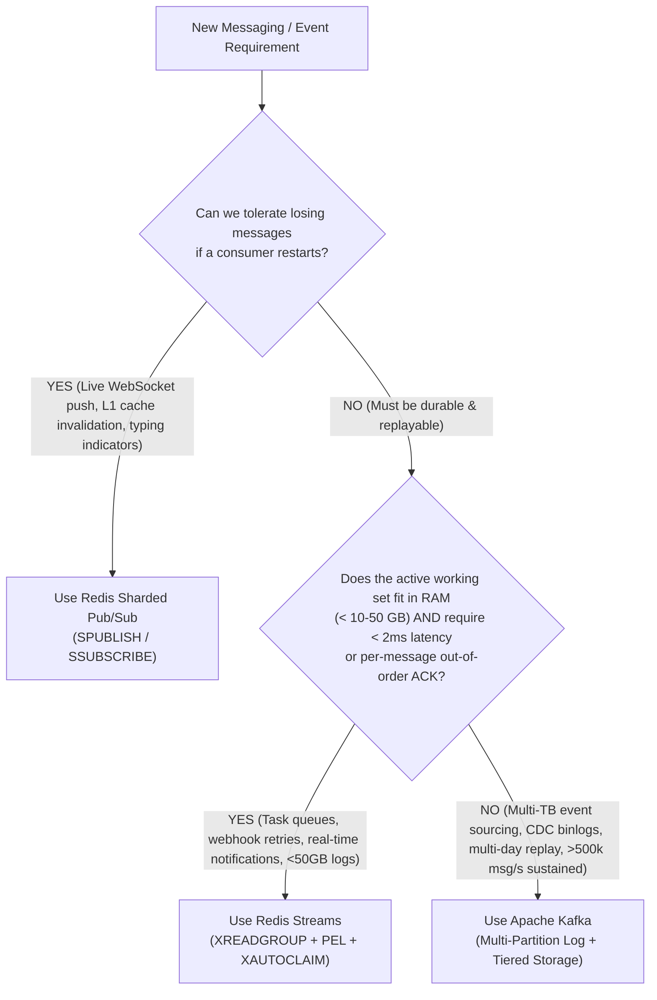

# Phase 3 Manual: Distributed Architecture, Comparative Trade-offs & Staff/Principal Patterns

This manual covers the Staff and Principal Engineer architectural patterns for operating Redis beyond caching at scale: **The Definitive Architectural Showdown (Redis Pub/Sub vs. Redis Streams vs. Apache Kafka), Redis Cluster Sharding & `CROSSSLOT` Solutions for Multi-Key Analytics, Durability & Split-Brain Persistence Hazards for Streams, the Full Probabilistic Toolkit (HyperLogLog, Bloom, Cuckoo, Count-Min Sketch, Top-K), and Production Observability**.

---

## Day 10: Architectural Showdown — Redis Pub/Sub vs. Redis Streams vs. Apache Kafka

One of the most frequent Staff/Principal system design interview questions is:
> *"We already have Redis and Kafka in our stack. Should we use Redis Pub/Sub, Redis Streams, or Apache Kafka for this event pipeline?"*

### 1. Comprehensive Architectural Comparison Matrix

| Dimension | Redis Pub/Sub | Redis Streams | Apache Kafka |
| :--- | :--- | :--- | :--- |
| **Primary Abstraction** | Ephemeral in-memory broadcast channel | In-memory append-only Radix Tree log (`rax` + `listpack`) | Distributed disk-backed partitioned commit log |
| **Storage Medium** | None (Direct socket buffer push) | **DRAM** (+ AOF/RDB persistence) | **Sequential Disk + OS Page Cache** (+ Tiered Object Storage) |
| **Delivery Guarantee** | **At-Most-Once** (Fire-and-forget; offline subscribers lose data) | **At-Least-Once** (Explicit `XACK`, PEL tracking, `XAUTOCLAIM`) | **At-Least-Once** or **Exactly-Once** (Idempotent + Transactional API) |
| **Message Retention** | `0 ms` (Deleted immediately after socket write) | Bounded by RAM (`MAXLEN ~ N` or `MINID ~ ts`, typically hours/days) | Days, weeks, or infinite (`cleanup.policy=compact` / S3 tiered storage) |
| **Routing & Fan-Out** | Push broadcast to **all** connected subscribers | Pull-based Consumer Groups (`XREADGROUP`) + Fan-out across groups | Pull-based Consumer Groups pinned to topic partitions |
| **Ordering vs. Acking** | Ordered per TCP connection | **Out-of-order ACK (`XACK`) per message ID** (1 slow msg does NOT block offset!) | **Partition-level sequential offset** (1 slow msg blocks partition commit or requires out-of-band DLQ) |
| **End-to-End Latency** | **$0.1\text{ ms} - 0.5\text{ ms}$** (Ultra-low) | **$0.3\text{ ms} - 1.5\text{ ms}$** (Sub-millisecond) | **$3\text{ ms} - 15\text{ ms}$** (Batching & disk fsync/replication trade-off) |
| **Max Throughput / Node**| ~500k – 1M msgs/sec (CPU & network bound) | ~200k – 500k msgs/sec (Single-threaded per stream key) | **Millions of msgs/sec** (Zero-copy `sendfile` + multi-partition disk I/O) |

---

### 2. Why Redis Streams Outshines Kafka for Fine-Grained Work Queues (The PEL Advantage)

In **Apache Kafka**, a consumer group tracks a single high-water mark `committed_offset` per partition. Furthermore, maximum consumer parallelism is strictly capped by the number of partitions ($C_{\max} \le P$).
- If Partition 0 has messages `100, 101, 102`, and message `100` takes 30 seconds to process while `101` and `102` take 5ms, you cannot advance the partition offset past `100` without risking data loss on crash—or you can only assign **1 worker thread** to that entire partition.

In **Redis Streams**:
```
Stream Key: "jobs:video_transcode" (Single Stream Key!)
        │
        ├──► Worker 1 claims Msg 100-0 (Takes 45s) ──► Tracked individually in PEL
        ├──► Worker 2 claims Msg 101-0 (Takes 10ms) ──► Calls XACK 101-0 immediately!
        ├──► Worker 3 claims Msg 102-0 (Takes 12ms) ──► Calls XACK 102-0 immediately!
        └──► Worker 50 claims Msg 150-0 (Takes 8ms) ──► Calls XACK 150-0 immediately!
```
- **50 consumers can concurrently pull from a single Redis Stream key**, acknowledging individual message IDs out-of-order (`XACK`) while Redis tracks only the unacknowledged IDs in the **Pending Entries List (PEL)** Radix Tree!

---

### 3. Staff-Level Decision Framework



---

## Day 11: Redis Cluster Constraints for Non-Caching Workloads

When running Redis Cluster (16,384 hash slots distributed across $M$ shards), operations that span multiple keys or broadcast across nodes require careful topology design.

---

### 1. The Pub/Sub Cluster Broadcast Storm vs. Sharded Pub/Sub (`SPUBLISH`)

```
[Legacy PUBLISH in a 50-Node Redis Cluster]
Publisher ──(PUBLISH chat:1 "hi")──► Node 1
                                       ├──► Broadcasts to Node 2
                                       ├──► Broadcasts to Node 3
                                       └──► Broadcasts to Node 50!
💥 Every node in the cluster processes every published message on its main thread!
   Cluster CPU and network saturate horizontally as nodes are added!

[Redis 7.0+ Sharded Pub/Sub (SPUBLISH)]
Publisher ──(SPUBLISH chat:1 "hi")──► CRC16("chat:1") % 16384 = Slot 9142 (Owned by Node 14)
                                       └──► Routed ONLY to Node 14 (and its replicas)!
✅ Adding more shards linearly increases total Pub/Sub capacity!
```

---

### 2. Solving `CROSSSLOT` Errors for `PFMERGE`, `BITOP`, and `GEOSEARCHSTORE`

In Redis Cluster, any command that reads or writes multiple keys (`PFMERGE`, `BITOP`, `GEOSEARCHSTORE`, or multi-key Lua scripts) requires **all keys in the command to map to the exact same hash slot**.

```redis
# ❌ FAILS IN REDIS CLUSTER:
# CRC16("uv:2026-11-07") = Slot 4120 | CRC16("uv:2026-11-08") = Slot 12891
PFMERGE uv:week uv:2026-11-07 uv:2026-11-08
# (error) CROSSSLOT Keys in request don't hash to the same slot
```

#### Solution A: Domain-Scoped Hash Tags `{...}`
Wrap the tenant, metric, or region identifier in curly braces `{}` so daily keys for the same metric co-locate on the same shard:
```redis
# ✅ SUCCEEDS IN REDIS CLUSTER (All hash on "metric:homepage_uv"):
PFMERGE {metric:homepage_uv}:week {metric:homepage_uv}:2026-11-07 {metric:homepage_uv}:2026-11-08
BITOP AND {cohort:ios_login}:retained {cohort:ios_login}:day1 {cohort:ios_login}:day2
```
> **Anti-Pattern Warning:** Never use a single global hash tag like `{analytics}:uv:day1` for **all** metrics in your company—that forces 100% of analytics keys onto a single Redis shard! Always scope the hash tag to the smallest unit that ever needs to be merged together (e.g., `{tenant_42:uv}:day1` or `{video_991:views}:hour1`).

#### Solution B: Client-Side Register Merging (Zero `CROSSSLOT` Constraint)
Because a HyperLogLog is physically stored as a normal Redis string (`HYLL` header + 12,288 bytes), if two HLL keys live on *different* shards, your Go service can simply:
1. Run `GET hll_key_1` on Shard A and `GET hll_key_2` on Shard B.
2. Write both 12KB byte slices to temporary co-located keys `{temp_merge_req_1}:a` and `{temp_merge_req_1}:b` and call `PFMERGE`, or merge their 6-bit registers directly in Go memory!

---

### 3. Horizontally Partitioning a High-Throughput Redis Stream

A single Redis Stream key (`orders:stream`) lives on a single hash slot on a single Redis master CPU core, capping write throughput at ~200,000 `XADD` ops/sec.

To scale a logical stream to **2,000,000 msgs/sec across 10 shards**:
```
Logical Stream: "orders:stream" ──► Sharded into K=16 Physical Stream Keys:
  • orders:stream:{0}   (Maps to Shard 1)
  • orders:stream:{1}   (Maps to Shard 2)
  ...
  • orders:stream:{15}  (Maps to Shard 10)
```
- **Producers:** Hash the routing key (e.g., `crc32(OrderID) % 16`) to preserve per-order ordering, or round-robin across `orders:stream:{0..15}`.
- **Consumers:** Each worker instance subscribes to a subset of the 16 stream shards using `XREADGROUP`.

---

## Day 12: Durability, Persistence & Replication Hazards for Streams

When engineers replace Kafka or RabbitMQ with Redis Streams, they often overlook **two critical failure modes** that can cause silent message loss or duplicate processing.

---

### 1. Hazard 1: Asynchronous Replication Split-Brain & `WAITAOF` (Redis 7.2+)

By default, Redis replication (`PSYNC2`) and AOF disk flushing (`appendfsync everysec`) are **asynchronous**:

```
1. Producer sends: XADD payments:stream * id "PAY-999" amount "5000"
2. Redis Master writes to RAM and replies "1730500001000-0" immediately (< 0.2ms).
3. 5ms later (BEFORE Master replicates to Replica-1 or fsyncs AOF to disk):
   💥 Master machine suffers power loss!
4. Sentinel promotes Replica-1 to Master.
   Result: Payment PAY-999 is permanently lost even though the Producer received a success ID!
```

#### The Production Fix for High-Value Streams (`WAIT` and `WAITAOF`):
Immediately after `XADD` (or inside a pipeline), issue `WAIT` or `WAITAOF`:
```redis
# 1. Append critical event
XADD payments:stream * id "PAY-999" amount "5000"

# 2. Block until written to local AOF AND acknowledged by at least 1 replica's AOF within 1000ms (Redis 7.2+)
WAITAOF 1 1 1000

# (Or on Redis < 7.2, block until replicated to at least 1 replica in memory):
WAIT 1 1000
```
Combined with `min-replicas-to-write 1` and `min-replicas-max-lag 5`, this bounds any failover window and guarantees your Stream entry exists on multiple physical machines before your API returns `200 OK`.

---

### 2. Hazard 2: Catastrophic Stream Deletion under `allkeys-lru`

Suppose a Redis cluster stores both:
- `cache:product:*` keys (with 10-minute TTLs).
- `orders:stream` (a Redis Stream with **no TTL**, holding 50,000 unprocessed orders and consumer group offsets).

If `maxmemory-policy` is set to `allkeys-lru` or `allkeys-lfu` and memory hits 100%:
- Redis views `orders:stream` as **a single key**!
- If `orders:stream` happens to be sampled and evicted, **Redis deletes the entire stream, all 50,000 queued messages, all Consumer Groups, and the entire Pending Entries List in a single instant!**

#### Mandatory Production Defenses for Streams:
1. **Isolate Instances or Use `volatile-lru` / `noeviction`:** Never run durable Streams on an `allkeys-*` instance. Under `volatile-lru`, Redis only evicts keys that have an explicit `EXPIRE` / `TTL` set, guaranteeing permanent keys (Streams, HLLs, Geo ZSETs) are **never** touched by the eviction loop.
2. **Enforce `MAXLEN ~` or `MINID ~` on Every `XADD`:** Never call an unbounded `XADD`. Always cap the stream's memory footprint:
   ```redis
   XADD orders:stream MAXLEN ~ 100000 * order_id "101"
   ```

---

## Day 13: The Full Probabilistic Data Structure Toolkit

At the Staff level, you must know which probabilistic structure solves which mathematical question:

```
┌───────────────────────────┬─────────────────────────────────────────┬───────────────────────────┬─────────────────────┐
│ Probabilistic Structure   │ Mathematical Question Answered          │ Typical Memory Footprint  │ Error / Behavior    │
├───────────────────────────┼─────────────────────────────────────────┼───────────────────────────┼─────────────────────┤
│ 1. HyperLogLog (HLL)      │ "How many unique items have we seen?"   │ Fixed 12 KB (16,384 regs) │ ±0.81% std error    │
│    (PFADD / PFCOUNT)      │ Cardinality: |Set|                      │                           │                     │
├───────────────────────────┼─────────────────────────────────────────┼───────────────────────────┼─────────────────────┤
│ 2. Bloom Filter           │ "Have we ever seen item X before?"      │ ~1.2 Bytes per item       │ 0% False Negatives  │
│    (BF.ADD / BF.EXISTS)   │ Set Membership (Insert-Only): X in Set? │ (at 1% false positive)    │ ~1% False Positives │
├───────────────────────────┼─────────────────────────────────────────┼───────────────────────────┼─────────────────────┤
│ 3. Cuckoo Filter          │ "Is item X currently in the set?"       │ ~1.5 Bytes per item       │ Supports Deletions! │
│    (CF.ADD / CF.DEL)      │ Dynamic Membership (Insert + Delete)    │ (Fingerprints in buckets) │ (`CF.DEL`)          │
├───────────────────────────┼─────────────────────────────────────────┼───────────────────────────┼─────────────────────┤
│ 4. Count-Min Sketch (CMS) │ "How many times did item X occur?"      │ Fixed 2D matrix (w x d)   │ Never undercounts;  │
│    (CMS.INCRBY / QUERY)   │ Point Frequency Estimation: Count(X)    │ (~64 KB – 512 KB)         │ bounded overcount   │
├───────────────────────────┼─────────────────────────────────────────┼───────────────────────────┼─────────────────────┤
│ 5. Top-K HeavyKeeper      │ "What are the K most frequent items?"   │ Fixed (~50 KB for Top 100)│ Exponential decay   │
│    (TOPK.ADD / TOPK.LIST) │ Heavy-Hitter Ranking (Trending / DDoS)  │                           │ evicts mice flows   │
└───────────────────────────┴─────────────────────────────────────────┴───────────────────────────┴─────────────────────┘
```

---

### Deep Dive: Count-Min Sketch (`CMS`) & `Top-K` vs. Sorted Sets (`ZSET`)

Suppose you want to find the **Top 50 Trending Search Queries** or **Top 100 High-Rate IP Addresses** out of 500,000,000 unique searches per day:
- **If you use a `ZSET` (`ZINCRBY`):** You must store all 500,000,000 unique strings in the ZSET! That consumes **40+ Gigabytes of RAM** just to inspect the top 50!
- **With Count-Min Sketch (`CMS`) + HeavyKeeper (`TOPK`):**
  ```
  Count-Min Sketch (d=4 Hash Functions x w=8,192 Counters):
           Col 0    Col 1    Col 2   ...   Col 8191
  Hash 1 [   0   ][  421  ][   12  ] ... [    0   ]  ◄── h1("iphone") = Col 1
  Hash 2 [   5   ][   0   ][  419  ] ... [    3   ]  ◄── h2("iphone") = Col 2
  Hash 3 [  450  ][   2   ][   0   ] ... [    0   ]  ◄── h3("iphone") = Col 0
  Hash 4 [   0   ][   0   ][   8   ] ... [  419   ]  ◄── h4("iphone") = Col 8191

  Estimated Frequency("iphone") = min(421, 419, 450, 419) = 419!
  ```
  Because hash collisions can only *increase* a bucket's counter, taking the **minimum across $d$ rows** strips away collision noise and returns the item's frequency in **constant memory (~128 KB)** regardless of whether you have 1 million or 100 billion unique items!

---

## Day 14: Production Observability, Sizing & Consumer Lag Diagnosis

### 1. Memory Sizing Formulas for Non-Caching Structures

| Data Structure | Exact Capacity Sizing Formula | Example Calculation |
| :--- | :--- | :--- |
| **HyperLogLog** | $\text{RAM} = \text{NumKeys} \times 12.3\text{ KB}$ (Dense) | $100,000 \text{ HLL keys} \times 12.3\text{ KB} \approx \mathbf{1.23\text{ GB}}$ |
| **Bitmap** | $\text{RAM} = \frac{\text{MaxBitOffset}}{8\text{ bits/byte}}$ | $\text{Max UserID } 200,000,000 / 8 = \mathbf{25\text{ MB per bitmap}}$ |
| **Bitfield (`uN`)**| $\text{RAM} = \frac{\text{MaxIndex} \times N\text{ bits}}{8}$ | $50,000,000 \text{ users} \times 4\text{ bits} / 8 = \mathbf{25\text{ MB}}$ |
| **Geospatial (`ZSET`)**| $\text{RAM} \approx \text{Members} \times (\text{MemberLen} + 96\text{B ZSET overhead})$ | $1,000,000 \text{ drivers} \times 112\text{B} \approx \mathbf{112\text{ MB}}$ |
| **Redis Stream** | $\text{RAM} \approx \text{Entries} \times (\text{RawValuesLen} + 16\text{B listpack delta})$ | $1,000,000 \text{ events (100B payload)} \approx \mathbf{116\text{ MB}}$ |

---

### 2. Diagnosing Redis Streams Consumer Lag (`XINFO GROUPS` & `XINFO CONSUMERS`)

In Redis 7.0+, `XINFO GROUPS <stream>` reports two critical metrics for every consumer group:
1. **`lag`:** The number of entries in the stream that have **not yet been delivered** to the consumer group (`stream_last_id - group_last_delivered_id`).
   - *High `lag` = Your consumers are pulling (`XREADGROUP ... >`) slower than producers are calling `XADD`. Scale out more consumer pods!*
2. **`pending`:** The number of entries that **have been delivered** to consumers in the group, but have **not yet been acknowledged via `XACK`**.
   - *High `pending` with high `idle` time = A consumer pod crashed while holding messages, or a poison message is failing repeatedly without a Dead-Letter Queue (`XAUTOCLAIM` + DLQ missing)!*

```bash
# Inspect Consumer Group Lag & Pending Count via CLI:
docker exec -it redis-master redis-cli XINFO GROUPS orders:stream

# Inspect per-consumer idle times and pending counts:
docker exec -it redis-master redis-cli XINFO CONSUMERS orders:stream billing-cg
```

---

### 3. Production Prometheus Alerting Thresholds (Beyond Caching)

| Subsystem | Metric / Inspection Command | Alert Threshold | Root Cause & Remediation |
| :--- | :--- | :--- | :--- |
| **Streams** | `redis_stream_group_lag` (`XINFO GROUPS` `lag`) | `> 10,000` for 3m | Consumer group throughput falling behind `XADD` rate; autoscale consumers |
| **Streams PEL** | `redis_stream_group_pending` (`pending`) | `> 1,000` & `idle > 60s`| Worker crash or missing `XACK` / `XAUTOCLAIM` reaper loop |
| **Pub/Sub** | `CLIENT LIST TYPE pubsub` (`omem` bytes) | `omem > 16MB` (50% of 32MB hard limit) | Slow subscriber failing to drain TCP socket; risk of abrupt disconnect |
| **Pub/Sub** | `PUBSUB NUMPAT` | `> 5,000` active patterns | Excessive $O(P)$ pattern subscriptions degrading `PUBLISH` CPU |
| **Bitmaps** | `MEMORY USAGE <bitmap_key>` | `> 64MB` unexpected jump | Unmapped sparse/64-bit UserID passed as `SETBIT` offset |

---

## Phase 3 Mastery & Staff Design Interview Checklist

Verify your mastery of Phase 3 with the Staff/Principal review questions below:

- [ ] **Q: Why does a single slow message block partition progress in Apache Kafka, whereas it does not block other workers in Redis Streams?**
  - *A:* Kafka tracks a sequential partition offset; committing offset $N+1$ implicitly acknowledges offset $N$. Redis Streams maintains an explicit Radix Tree Pending Entries List (PEL) per consumer group, allowing workers to `XACK` messages $101, 102, 103$ out-of-order while message $100$ remains in the PEL until completed or reclaimed via `XAUTOCLAIM`.

- [ ] **Q: Why does legacy `PUBLISH` struggle in a large 100-node Redis Cluster, and how does Redis 7 `SPUBLISH` fix it?**
  - *A:* Legacy `PUBLISH` broadcasts every message to all 100 nodes in the cluster ($O(N)$ network and CPU amplification), regardless of where subscribers are connected. `SPUBLISH` hashes the channel name to a specific CRC16 hash slot and restricts message propagation strictly to the shard owning that slot.

- [ ] **Q: What happens if a developer passes a random UUID hash or a 64-bit Snowflake ID (`4,000,000,000`) as the offset to `SETBIT`?**
  - *A:* Redis Bitmaps allocate a contiguous byte array up to the highest bit offset. Setting bit `4,000,000,000` immediately allocates $4 \times 10^9 / 8 \approx 500\text{ MB}$ of zero-padded RAM in a single command, blocking the main thread!

- [ ] **Q: How do you guarantee that a critical financial event written via `XADD` to a Redis Stream is not lost if the Redis Master crashes 2 milliseconds later?**
  - *A:* Enable `appendonly yes` and follow `XADD` with `WAITAOF 1 1 <timeout>` (Redis 7.2+) or `WAIT 1 <timeout>` alongside `min-replicas-to-write 1`, ensuring the entry is persisted to local AOF and replicated to at least one replica before acknowledging the producer.
