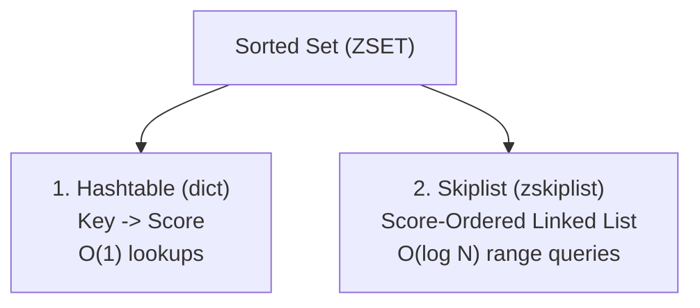
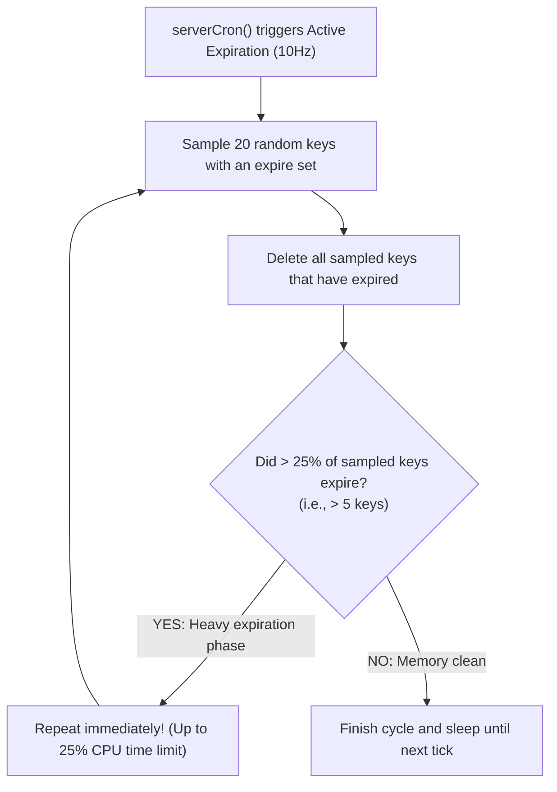

# Phase 1 Manual: Memory Mechanics, Data Structures & Eviction Policies

This manual guides you through the foundational mechanics of caching engines using official CLI tools inside the Phase 0 environment. You will master **Redis internal memory layouts (SDS, listpack, skiplist, dict), passive vs active TTL expiration, exact vs approximated LRU/LFU eviction algorithms, and Memcached's slab allocator vs Redis's jemalloc**.

---

## Prerequisites

Ensure your Phase 0 cluster is running:
```bash
docker compose -f cache/docker-compose.yml up -d
docker compose -f cache/docker-compose.yml ps
```

---

## Day 1: Redis Data Structures & Memory Internals

### 1. Architectural Concept: What is a `redisObject`?
Every key-value entry stored in Redis is wrapped in a C structure called `redisObject`:

```c
struct redisObject {
    unsigned type:4;       // Object type: OBJ_STRING, OBJ_LIST, OBJ_SET, OBJ_ZSET, OBJ_HASH
    unsigned encoding:4;   // Internal representation: OBJ_ENCODING_RAW, OBJ_ENCODING_INT, OBJ_ENCODING_LISTPACK, etc.
    unsigned lru:24;       // LRU clock or LFU decay/frequency metadata (3 bytes)
    int refcount;          // Reference counter for memory management (4 bytes)
    void *ptr;             // 64-bit pointer to the actual data structure in memory (8 bytes)
}; // Total fixed overhead = 16 bytes per entry (before key or value memory is allocated!)
```

```
┌────────────────────────────────────────────────────────┐
│                   redisObject (16 Bytes)               │
│  [type: 4b] [encoding: 4b] [lru/lfu: 24b]              │
│  [refcount: 4 Bytes]                                   │
│  [*ptr: 8 Bytes] ──────────────────────────┐           │
└────────────────────────────────────────────┼───────────┘
                                             ▼
                      ┌──────────────────────────────────────────┐
                      │ Actual Data (SDS, listpack, dict, etc.)  │
                      └──────────────────────────────────────────┘
```

> **Takeaway:** Even storing a 1-character string `"a"` with key `"k"` incurs at least **16 bytes of metadata + jemalloc padding**. In a cache with 100 million keys, metadata alone consumes over 1.6 GB of RAM.

---

### 2. Simple Dynamic Strings (SDS)
Standard C strings are null-terminated (`\0`) character arrays. Redis replaces them with **SDS**:

```c
struct sdshdr8 {
    uint8_t len;         // Length of string (used bytes)
    uint8_t alloc;       // Total allocated memory buffer size
    unsigned char flags; // Header type (sdshdr5, 8, 16, 32, 64)
    char buf[];          // Actual character buffer with guaranteed '\0' terminator
};
```

#### Why SDS over C Strings?
1. **$O(1)$ String Length:** `STRLEN` does not scan memory; it reads the `len` field directly.
2. **Binary Safe:** Strings can contain arbitrary bytes, binary images, serialized protobufs, or null bytes (`\0`) without premature termination.
3. **Buffer Overflow Prevention:** Functions like `sdscat` automatically reallocate the buffer if appended text exceeds `alloc`.
4. **Dynamic Pre-Allocation:** Allocations under 1MB allocate double the requested space to eliminate repeated `malloc` calls during frequent appends.

---

### 3. Compact Encodings: `ziplist` and `listpack`
Pointers in 64-bit systems consume **8 bytes** each. Storing small lists, hashes, or sets as standard linked lists or hash tables wastes up to 80% of memory on pointers and metadata headers.

Redis solves this using **`listpack`** (the modern successor to `ziplist`):
- A contiguous, sequential block of raw bytes in memory.
- Contains no pointers. Elements are packed tightly with variable-length integer and string encodings.
- Elements are traversed by calculating offset bytes.

```
Standard Linked List (Pointer Heavy - 24 bytes per node + value):
[Node Header (16B)] ──► [Prev: 8B] ──► [Next: 8B] ──► [Value Ptr: 8B] ──► "data"

Compact Listpack (Zero pointer overhead):
┌───────────┬───────────┬────────────────┬────────────────┬───────┐
│ TotalBytes│ NumElems  │ Entry 1 (Len+V)│ Entry 2 (Len+V)│  End  │
│  (4B)     │   (2B)    │  "user:101"    │     "Alice"    │ (0xFF)│
└───────────┴───────────┴────────────────┴────────────────┴───────┘
```

#### Automatic Encoding Escalation:
When a collection exceeds configured thresholds, Redis transparently transitions the structure to a full pointer-based structure:
- Hashes: `listpack` $\rightarrow$ `hashtable` (`dict`) when `hash-max-listpack-entries > 512` or `hash-max-listpack-value > 64` bytes.
- Lists: `quicklist` (a doubly-linked list of compact listpack blocks).

---

### 4. Sorted Sets (ZSET): The Skiplist + Hashtable Duality
A ZSET allows $O(1)$ score lookups while simultaneously providing $O(\log N)$ rank and range queries (`ZRANGEBYSCORE`). Redis achieves this by allocating **two data structures simultaneously**:



#### How a Skiplist Works:
A skiplist is a probabilistic multi-level linked list. Each node is randomly assigned a level based on a geometric distribution ($p = 0.25$, max level 32):

```
Level 3:  [Head] ──────────────────────────────────────────────► [Node 8] ──► NULL
Level 2:  [Head] ──────────────────────► [Node 4] ─────────────► [Node 8] ──► NULL
Level 1:  [Head] ──────────► [Node 2] ──► [Node 4] ──► [Node 6] ──► [Node 8] ──► NULL
Level 0:  [Head] ──► [N1] ──► [N2] ──► [N3] ──► [N4] ──► [N5] ──► [N6] ──► [N7] ──► [N8]
```
Searching for element `7`: Drops down from Level 3 to Level 2 $\rightarrow$ jumps to Node 4 $\rightarrow$ drops to Level 1 $\rightarrow$ checks Node 6 $\rightarrow$ finds Node 7. Time complexity: $O(\log N)$ without the heavy rebalancing overhead of Red-Black or AVL trees!

---

### 5. Hands-On Lab: Inspecting Encodings
Connect to `redis-master`:
```bash
docker exec -it redis-master redis-cli
```

#### Test String Encoding:
```redis
# 1. Integers are encoded as native 64-bit longs (zero SDS overhead)
SET counter 100
OBJECT ENCODING counter
# "int"

# 2. Short strings (< 44 bytes) use EMBSTR (redisObject + SDS allocated in ONE single malloc call)
SET short_str "hello_world"
OBJECT ENCODING short_str
# "embstr"

# 3. Long strings (> 44 bytes) use RAW (redisObject and SDS allocated in two separate malloc calls)
SET long_str "this_is_a_very_long_string_that_exceeds_the_forty_four_byte_embstr_threshold_limit"
OBJECT ENCODING long_str
# "raw"
```

#### Test Hash Encoding Escalation:
```redis
# Store small hash
HSET user:profile name "Alice" role "Admin"
OBJECT ENCODING user:profile
# "listpack"

# Inject large value exceeding 64 bytes
HSET user:profile bio "This is an extremely long bio string designed specifically to exceed the 64-byte limit and force Redis to convert this listpack into a hashtable."
OBJECT ENCODING user:profile
# "hashtable"
```

---

## Day 2: Expiration Internals & TTL Lifecycle

### 1. The Myth of the "Background Timer"
A common misconception is that Redis attaches a background timer to every expiring key that deletes it the millisecond its TTL reaches zero. **This is false.** In an engine storing 50 million keys, 50 million active hardware timers would paralyze the CPU.

Redis uses a hybrid combination of **Passive Expiration** and **Active Probabilistic Expiration**.

```
                           KEY ACCESS / WRITE
                                   │
                                   ▼
                    Does key have an expired TTL?
                                   │
                    ┌──────────────┴──────────────┐
                   YES                            NO
                    │                             │
         Delete key from RAM;              Return key data
         Replicate 'DEL' to replicas;      to client
         Return nil to client
         (PASSIVE / LAZY EXPIRATION)
```

---

### 2. Active Expiration Algorithm (The 10Hz Cron)
Ten times per second (`serverCron` at 100ms intervals), Redis executes active expiration:



#### The Unread Key Memory Problem:
If an application writes 10,000,000 keys with a 1-hour TTL, but never reads them again:
- Passive expiration will **never touch them**.
- Active expiration samples only **20 keys per tick**.
- Result: Expired keys linger in RAM until active sampling catches up, or until memory reaches `maxmemory` and triggers **Eviction**.

---

### 3. Hands-On Lab: Observing Active Expiration
In `redis-cli`:
```redis
# 1. Clear database
FLUSHDB

# 2. Check memory baseline
INFO memory
# Look at used_memory_human

# 3. Write 50,000 keys with a 2-second TTL
EVAL "for i=1,50000 do redis.call('SET', 'temp_key:'..i, 'payload_value_12345', 'EX', 2) end" 0

# Check keyspace immediately
INFO keyspace
# db0:keys=50000,expires=50000

# 4. Wait 3 seconds without reading any keys
# Watch active expiration clean the keyspace in real time:
INFO keyspace
# Observe 'keys' declining rapidly towards 0 via active sampling
```

---

## Day 3: Eviction Policies & Algorithmic Trade-offs

When `used_memory` reaches `maxmemory`, Redis stops relying on TTL and invokes its **Eviction Policy** to reclaim memory.

### 1. The 8 Eviction Policies

| Eviction Policy | Target Keys | Eviction Criteria | Production Use Case |
| :--- | :--- | :--- | :--- |
| **`noeviction`** | None | Returns OOM errors on all writes (`OOM command not allowed when used memory > 'maxmemory'`) | Critical financial caches where data loss is prohibited |
| **`allkeys-lru`** | All keys | Evicts least recently accessed keys | **Default standard web application cache** |
| **`volatile-lru`** | Keys with TTL | Evicts least recently accessed among keys with an expiration | Cache where static reference data shares RAM with temp data |
| **`allkeys-lfu`** | All keys | Evicts least frequently accessed keys | Ideal for workloads with stable long-term hot keys |
| **`volatile-lfu`**| Keys with TTL | Evicts least frequently accessed among keys with an expiration | Frequency-based caching with persistent unexpiring keys |
| **`volatile-ttl`**| Keys with TTL | Evicts keys with the shortest remaining TTL first | Pre-emptive expiration acceleration |
| **`allkeys-random`**| All keys | Evicts random keys | Testing or uniform access patterns |
| **`volatile-random`**| Keys with TTL | Evicts random keys with TTL | Rarely used in production |

---

### 2. Exact LRU vs Approximated LRU in Redis

In standard computer science textbooks, an **LRU (Least Recently Used)** cache is implemented using a **Hash Map + Doubly-Linked List**:

```
Textbook Doubly-Linked List LRU:
[Head: Most Recent] ◄──► [Node A] ◄──► [Node B] ◄──► [Node C] ◄──► [Tail: Evict First]
```

#### Why Redis Rejects True Linked-List LRU:
- Every node in a doubly-linked list requires two pointers: `prev` (8 bytes) and `next` (8 bytes) = **16 bytes**.
- Combined with malloc metadata, true LRU requires **~24 bytes of memory overhead per key**.
- Across 100,000,000 keys, that equals **2.4 Gigabytes of RAM wasted exclusively on LRU pointers**!
- Furthermore, on every single read operation (`GET`), the node must be detached and spliced onto the head, causing lock contention and memory cache-line invalidation.

---

### 3. Redis Approximated LRU with Eviction Pools
Instead of pointers, Redis uses an **approximated sampling algorithm**:
1. Every `redisObject` stores a **24-bit timestamp clock** (`lru`).
2. When a key is accessed, its `lru` field is updated with the current timestamp.
3. When memory is full, Redis randomly samples $N$ keys (default `maxmemory-samples 5`, or `16` in modern versions).
4. Redis maintains an **Eviction Pool** of the 16 best eviction candidates, sorted by idle time ($T_{\text{now}} - T_{\text{last\_access}}$).
5. The key with the highest idle time is evicted.

```
Redis 16-Candidate Eviction Pool:
[Candidate 1: Idle 120s] ──► [Candidate 2: Idle 550s] ──► [Candidate 16: Idle 9800s] ──► EVICT!
```

> **Performance:** With `maxmemory-samples 10`, Redis approximated LRU achieves **99.5% accuracy** compared to theoretical exact LRU, while consuming **0 extra bytes of pointer memory**.

---

### 4. LFU (Least Frequently Used) Internals
LRU has a major flaw: if an infrequent key is read once during a database backup scan, its idle time resets to 0, causing Redis to keep it and evict a key that was read 1,000,000 times earlier.

**LFU** tracks access **frequency**, not just recency. Redis packs LFU into the exact same 24-bit `lru` field:
- **Higher 16 bits:** Last Decrement Time (LDT) in minutes.
- **Lower 8 bits:** Logistic Counter (LOG_C) (0 to 255).

#### The Morris Counter Algorithm:
An 8-bit counter can only count up to 255. How does Redis count millions of hits? **Logarithmic probability**:

$$P(\text{increment}) = \frac{1}{\text{counter} \cdot \text{lfu\_log\_factor} + 1}$$

```redis
# With lfu_log_factor = 10:
Counter Value 100 represents ~30,000 accesses
Counter Value 255 represents > 1,000,000 accesses
```

#### Time-Based Decay:
To prevent historical hot keys from occupying cache forever, the counter decays over time. If a key is accessed, Redis checks how many minutes have passed since `LDT`. For every `lfu-decay-time` minutes elapsed, the counter is decremented.

---

### 5. Hands-On Lab: LRU vs LFU Eviction Simulation
Let's test eviction live by constraining Redis memory to 2MB.

```bash
docker exec -it redis-master redis-cli
```

```redis
# 1. Cap memory to 2MB and set policy to allkeys-lru
CONFIG SET maxmemory 2mb
CONFIG SET maxmemory-policy allkeys-lru

# 2. Populate three keys
SET key_frequent "important_value"
SET key_recent "recent_value"

# 3. Simulate heavy usage of key_frequent
INCR key_frequent
INCR key_frequent
INCR key_frequent

# 4. Fill memory until eviction occurs
EVAL "for i=1,5000 do redis.call('SET', 'filler:'..i, string.rep('X', 500)) end" 0

# 5. Check if key_frequent was evicted under LRU
GET key_frequent
# Look at eviction statistics:
INFO stats
# Look at 'evicted_keys'
```

---

## Day 4: Memcached vs. Redis Architecture

Engineers often ask: *"Why does Memcached still exist if Redis has data structures and persistence?"*

Understanding the architectural differences determines when to choose which tool.

```
┌───────────────────────────────────────────────┬───────────────────────────────────────────────┐
│ REDIS ARCHITECTURE                            │ MEMCACHED ARCHITECTURE                        │
├───────────────────────────────────────────────┼───────────────────────────────────────────────┤
│ Single-Threaded Core Event Loop               │ Multi-Threaded Architecture (libevent worker  │
│ (Non-blocking multiplexed epoll)              │ threads over connection pool)                 │
│                                               │                                               │
│ Dynamic Memory Allocation (`jemalloc`)        │ Pre-Allocated Slab Memory Allocator           │
│ Subject to memory fragmentation               │ Zero external memory fragmentation            │
│                                               │                                               │
│ Rich Data Structures                          │ Pure Key-Value Binary Strings only            │
│ (Hashes, Sets, ZSets, Streams, Bitmaps)       │ (Maximum 1MB per value default)               │
│                                               │                                               │
│ Persistence & High Availability               │ Transient volatile memory only                │
│ (RDB Snapshots, AOF Logs, Sentinel, Cluster)  │ (No persistence, no replication, no failover) │
└───────────────────────────────────────────────┴───────────────────────────────────────────────┘
```

---

### 1. Memcached Slab Allocation Mechanics
Memcached completely prevents Linux virtual memory fragmentation by allocating memory in advance using **Slabs**:

```
Memcached 128MB Memory Pool
  │
  ├── Slab Class 1 (Chunk Size: 96 Bytes)  ──► [Chunk][Chunk][Chunk][Chunk]...
  ├── Slab Class 2 (Chunk Size: 120 Bytes) ──► [Chunk][Chunk][Chunk][Chunk]...
  ├── Slab Class 3 (Chunk Size: 152 Bytes) ──► [Chunk][Chunk][Chunk]...
  └── Slab Class N (Chunk Size: Up to 1MB) ──► [Chunk]...
```

1. **Pages:** Memcached allocates memory from the OS in **1MB Pages**.
2. **Slab Classes:** Each 1MB page is carved into fixed-size **Chunks** based on a growth factor (default 1.25).
3. **Storage:** When you store a 100-byte value, Memcached assigns it to **Slab Class 2** (120-byte chunks).
4. **Internal Fragmentation:** The remaining 20 bytes in that chunk cannot be used by other keys. This is **internal fragmentation**—the trade-off for eliminating external OS fragmentation.

---

### 2. Benchmarking Multi-Threaded Memcached vs Redis
Memcached shines when vertical multi-core scalability is needed for simple string operations:
- A single Redis node utilizes **1 CPU core** for command execution.
- Memcached utilizes **all CPU cores** concurrently via thread worker pools.

Connect to Memcached via `nc` and inspect slab allocation:
```bash
printf "stats slabs\r\n" | nc localhost 11211
```
Observe `chunk_size`, `chunks_per_page`, `total_pages`, and `used_chunks`.

---

## Phase 1 Mastery & Exit Criteria Checklist

Before moving to Go application patterns in Phase 2, verify your mastery using the Q&A checklist below:

- [ ] **Q: Why does storing short strings in Redis use `embstr` instead of `raw`?**
  - *A:* `embstr` allocates the `redisObject` header (16B) and the SDS string in a **single contiguous `malloc` chunk**, reducing memory fragmentation and doubling CPU L1 cache locality. `raw` requires two separate memory allocations.

- [ ] **Q: Why does Redis use an Approximated LRU instead of a true Doubly-Linked List?**
  - *A:* True LRU requires 16–24 bytes of pointer overhead per key. Across 100M keys, that wastes ~2.4GB of RAM purely on pointers. Redis samples 16 keys probabilistically into an eviction pool, achieving 99.5% LRU accuracy with zero extra pointer overhead.

- [ ] **Q: How does LFU avoid keeping a historical hot key forever?**
  - *A:* Through time-based decay. The upper 16 bits of the 24-bit field store the Last Decrement Time (LDT). Every `lfu-decay-time` minutes without access decrements the logarithmic Morris counter.

- [ ] **Q: If a key's TTL expires, is it immediately wiped from RAM?**
  - *A:* No. It is wiped when next accessed (Passive Expiration) or sampled by the 10Hz background cron (Active Expiration). If unaccessed and unsampled, it remains in RAM until `maxmemory` eviction triggers.

- [ ] **Q: What is the fundamental difference in memory allocation between Redis and Memcached?**
  - *A:* Redis uses dynamic allocations via `jemalloc`, which can suffer from external fragmentation. Memcached pre-allocates memory into fixed-size Slab Classes (1MB pages carved into uniform chunks), completely eliminating external fragmentation at the cost of slight internal fragmentation.
