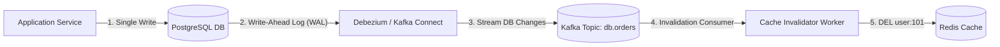

# Phase 2 Manual: Application Caching Patterns & Concurrency in Go

This manual guides you through building production-grade caching clients in Go. You will master **Cache-Aside, Write-Through, Write-Behind, solving the Thundering Herd / Cache Stampede via `singleflight` and the XFetch probabilistic early expiration algorithm, and building bulletproof distributed locks with atomic Lua scripts and Redlock**.

---

## Prerequisites & Go Environment Setup

Ensure your local Phase 0 cluster is running:
```bash
docker compose -f cache/docker-compose.yml up -d
```

### Go Module Initialization
Create a dedicated Go client directory (e.g., `cache/go-clients`):
```bash
mkdir -p cache/go-clients
cd cache/go-clients
go mod init cache-clients
go get github.com/redis/go-redis/v9@latest
go get golang.org/x/sync/singleflight@latest
go get github.com/google/uuid@latest
```

---

## Day 5: Core Caching Patterns

```
┌────────────────────────────────────────────────────────────────────────┐
│                        CORE CACHING PATTERNS                           │
├────────────────────┬────────────────────┬──────────────────────────────┤
│ CACHE-ASIDE        │ WRITE-THROUGH      │ WRITE-BEHIND (WRITE-BACK)    │
│ App manages both   │ App writes to cache│ App writes to cache/queue;   │
│ Cache and Database │ Cache writes to DB │ Worker asynchronously writes │
│ independently      │ synchronously      │ batched updates to DB        │
└────────────────────┴────────────────────┴──────────────────────────────┘
```

### 1. Cache-Aside (Lazy Loading) Implementation

In **Cache-Aside**, the application code is responsible for checking the cache first, querying the database on a miss, backfilling the cache, and invalidating the cache upon updates.

Create `cache/go-clients/cache_aside.go`:

```go
package main

import (
	"context"
	"database/sql"
	"encoding/json"
	"errors"
	"fmt"
	"log"
	"time"

	"github.com/redis/go-redis/v9"
)

type UserProfile struct {
	ID        string    `json:"id"`
	Email     string    `json:"email"`
	Tier      string    `json:"tier"`
	UpdatedAt time.Time `json:"updated_at"`
}

type UserRepository struct {
	rdb *redis.Client
}

func NewUserRepository(rdb *redis.Client) *UserRepository {
	return &UserRepository{rdb: rdb}
}

// Simulated slow database lookup (e.g. 100ms PostgreSQL query)
func (r *UserRepository) queryDatabase(ctx context.Context, userID string) (*UserProfile, error) {
	time.Sleep(100 * time.Millisecond) // Simulate DB I/O latency
	return &UserProfile{
		ID:        userID,
		Email:     fmt.Sprintf("%s@example.com", userID),
		Tier:      "PREMIUM_GOLD",
		UpdatedAt: time.Now().UTC(),
	}, nil
}

// GetUser demonstrates Cache-Aside Read logic
func (r *UserRepository) GetUser(ctx context.Context, userID string) (*UserProfile, error) {
	cacheKey := fmt.Sprintf("user:profile:%s", userID)

	// Step 1: Read from Redis cache
	cachedJSON, err := r.rdb.Get(ctx, cacheKey).Result()
	if err == nil {
		var profile UserProfile
		if err := json.Unmarshal([]byte(cachedJSON), &profile); err == nil {
			fmt.Printf("⚡ [CACHE HIT] Retrieved %s from Redis\n", userID)
			return &profile, nil
		}
	} else if !errors.Is(err, redis.Nil) {
		log.Printf("⚠️ Redis read error: %v (falling back to database)", err)
	}

	// Step 2: Cache Miss -> Query primary database
	fmt.Printf("🐢 [CACHE MISS] Querying primary database for %s...\n", userID)
	profile, err := r.queryDatabase(ctx, userID)
	if err != nil {
		return nil, err
	}

	// Step 3: Asynchronously backfill cache with TTL (e.g. 5 minutes)
	payload, _ := json.Marshal(profile)
	err = r.rdb.Set(ctx, cacheKey, payload, 5*time.Minute).Err()
	if err != nil {
		log.Printf("⚠️ Failed to populate cache: %v", err)
	}

	return profile, nil
}

// UpdateUser demonstrates Cache-Aside Write logic: Update DB, then Invalidate Cache
func (r *UserRepository) UpdateUser(ctx context.Context, profile *UserProfile) error {
	cacheKey := fmt.Sprintf("user:profile:%s", profile.ID)

	// Step 1: Update Database first
	fmt.Printf("💾 Updating user %s in primary database...\n", profile.ID)
	profile.UpdatedAt = time.Now().UTC()

	// Step 2: Invalidate Cache (DELETE key)
	// Never UPDATE the cache directly in concurrent systems to prevent stale overwrites!
	if err := r.rdb.Del(ctx, cacheKey).Err(); err != nil {
		log.Printf("⚠️ Cache eviction failed: %v", err)
	}
	fmt.Printf("🗑️ Evicted cache key '%s'\n", cacheKey)
	return nil
}

func main() {
	rdb := redis.NewClient(&redis.Options{Addr: "localhost:6379"})
	defer rdb.Close()
	ctx := context.Background()

	repo := NewUserRepository(rdb)

	// Test 1: First read causes a Cache Miss
	start := time.Now()
	user, _ := repo.GetUser(ctx, "usr_1001")
	fmt.Printf("First Fetch took: %v (Tier: %s)\n\n", time.Since(start), user.Tier)

	// Test 2: Second read causes a Cache Hit (sub-millisecond!)
	start = time.Now()
	user, _ = repo.GetUser(ctx, "usr_1001")
	fmt.Printf("Second Fetch took: %v (Tier: %s)\n\n", time.Since(start), user.Tier)

	// Test 3: Update user and observe cache invalidation
	user.Tier = "PLATINUM_VIP"
	_ = repo.UpdateUser(ctx, user)

	// Test 4: Next read misses and re-hydrates with new tier
	user, _ = repo.GetUser(ctx, "usr_1001")
	fmt.Printf("Post-Update Tier: %s\n", user.Tier)
}
```

---

## Day 6: Cache Stampede (Thundering Herd) & Concurrency Hazards

### 1. The Cache Stampede Problem
When a high-traffic "hot key" (e.g., an e-commerce flash sale catalog, an election result, a celebrity profile) expires:
1. 10,000 concurrent user requests query Redis at the same millisecond.
2. All 10,000 requests receive a **Cache Miss**.
3. All 10,000 requests query the database **simultaneously**.
4. The database connection pool is exhausted; CPU spikes to 100%; queries time out; the application crashes (**Cascading Failure**).

```
Hot Key Expired @ T=10.000s
        │
        ├──► Request 1 ──► Cache Miss ──┐
        ├──► Request 2 ──► Cache Miss ──┤
        ├──► Request 3 ──► Cache Miss ──┼──► 10,000 concurrent queries hit DB!
        ├──► ...                        │    💥 DATABASE OUTAGE (Cache Stampede)
        └──► Request 10k ─► Cache Miss ──┘
```

---

### 2. Solution A: In-Process Coalescing via `singleflight`

Go provides the standard `golang.org/x/sync/singleflight` package. It guarantees that **duplicate concurrent calls with the same key share a single execution**, while all other callers wait for that single result.

Create `cache/go-clients/stampede_singleflight.go`:

```go
package main

import (
	"context"
	"fmt"
	"sync"
	"sync/atomic"
	"time"

	"github.com/redis/go-redis/v9"
	"golang.org/x/sync/singleflight"
)

type SafeCache struct {
	rdb   *redis.Client
	group singleflight.Group
	dbHit int64
}

func (c *SafeCache) FetchHotKey(ctx context.Context, key string) (string, error) {
	// 1. Try cache
	val, err := c.rdb.Get(ctx, key).Result()
	if err == nil {
		return val, nil
	}

	// 2. Coalesce concurrent cache misses into 1 database execution
	result, err, shared := c.group.Do(key, func() (interface{}, error) {
		// Only ONE goroutine executes this block!
		atomic.AddInt64(&c.dbHit, 1)
		fmt.Printf("🔥 [DB HIT EXECUTED] Goroutine querying DB for key '%s'...\n", key)
		time.Sleep(150 * time.Millisecond) // Simulate expensive DB query

		computedData := fmt.Sprintf("fresh_data_at_%s", time.Now().Format(time.RFC3339Nano))
		_ = c.rdb.Set(ctx, key, computedData, 2*time.Second).Err()
		return computedData, nil
	})

	if err != nil {
		return "", err
	}
	if shared {
		// Other goroutines received the shared result without querying the DB!
	}
	return result.(string), nil
}

func main() {
	rdb := redis.NewClient(&redis.Options{Addr: "localhost:6379"})
	defer rdb.Close()
	ctx := context.Background()

	cache := &SafeCache{rdb: rdb}
	key := "flash_sale_inventory"
	_ = rdb.Del(ctx, key).Err() // Ensure cache starts empty

	fmt.Println("🚀 Simulating 1,000 concurrent requests during a Cache Miss...")
	var wg sync.WaitGroup
	requests := 1000

	start := time.Now()
	for i := 0; i < requests; i++ {
		wg.Add(1)
		go func(id int) {
			defer wg.Done()
			_, _ = cache.FetchHotKey(ctx, key)
		}(i)
	}
	wg.Wait()

	fmt.Printf("\n🏁 1,000 concurrent requests finished in %v\n", time.Since(start))
	fmt.Printf("📊 TOTAL DATABASE QUERIES EXECUTED: %d (Expected: 1, Stampede eliminated!)\n", cache.dbHit)
}
```

---

### 3. Solution B: Probabilistic Early Expiration (The XFetch Algorithm)

Published in VLDB 2015 by *Vattani, Chierichetti, and Lowenstein*, **XFetch** is an optimal mathematical algorithm where incoming reads probabilistically decide to refresh the cache **before the TTL actually reaches zero**.

#### Mathematical Formula:
A read request recomputes the cache if:
$$\Delta \cdot \beta \cdot (-\ln(\text{rand}())) > \text{remaining\_ttl}$$

Where:
- $\Delta$: Time taken to compute the value (in seconds).
- $\beta$: Aggressiveness factor (typically $1.0$).
- $\text{rand}()$: Uniform random float in the range $(0, 1]$.
- $\text{remaining\_ttl}$: Seconds until key expires.

```
Key TTL: 60s
T=0s                      T=50s (10s remaining)                T=60s (Expired)
─────────────────────────────┬─────────────────────────────────────┬──►
Very low probability of      │ Probability increases exponentially!│
early background refresh     │ Exactly ONE read triggers async DB  │ Never reached!
                             │ refresh. Key NEVER expires!         │
```

Create `cache/go-clients/xfetch.go`:

```go
package main

import (
	"context"
	"encoding/json"
	"fmt"
	"math"
	"math/rand"
	"time"

	"github.com/redis/go-redis/v9"
)

type CachedRecord struct {
	Value     string        `json:"val"`
	Delta     time.Duration `json:"delta"`      // Computation time
	ExpiresAt time.Time     `json:"expires_at"` // Logical expiration
}

// XFetch checks if probabilistic early background refresh should trigger
func ShouldRefreshEarly(rec CachedRecord, beta float64) bool {
	remainingTTL := time.Until(rec.ExpiresAt).Seconds()
	if remainingTTL <= 0 {
		return true // Already expired
	}

	deltaSec := rec.Delta.Seconds()
	if deltaSec <= 0 {
		deltaSec = 0.05 // default 50ms
	}

	// XFetch formula: -beta * delta * ln(rand())
	rnd := rand.Float64()
	if rnd == 0 {
		rnd = 0.0001 // avoid log(0)
	}
	earlyThreshold := -beta * deltaSec * math.Log(rnd)

	return earlyThreshold > remainingTTL
}

func main() {
	rdb := redis.NewClient(&redis.Options{Addr: "localhost:6379"})
	defer rdb.Close()

	rec := CachedRecord{
		Value:     "catalog_data",
		Delta:     200 * time.Millisecond,
		ExpiresAt: time.Now().Add(250 * time.Millisecond), // Only 250ms left!
	}

	refreshCount := 0
	samples := 1000
	for i := 0; i < samples; i++ {
		if ShouldRefreshEarly(rec, 1.0) {
			refreshCount++
		}
	}

	fmt.Printf("XFetch Simulation with %v remaining:\n", time.Until(rec.ExpiresAt))
	fmt.Printf("Out of %d reads, %d triggered a background refresh (%.1f%% chance)\n",
		samples, refreshCount, float64(refreshCount)/float64(samples)*100)
}
```

---

## Day 7: Distributed Locks with Redis (Redlock & Lua)

### 1. The Naive `SETNX` Pitfall
Early Redis tutorials recommended acquiring locks like this:
```redis
# ❌ VULNERABLE TO PERMANENT DEADLOCK:
SETNX lock:order 1
# If the app crashes right here before EXPIRE, the lock NEVER expires!
EXPIRE lock:order 10
```

### 2. The Atomic `SET ... NX PX` Primitive
Since Redis 2.6.12, acquire a lock in a single atomic command:
```redis
SET lock:order <unique_random_uuid> NX PX 10000
```
- `NX`: Only set if key does **not** already exist.
- `PX 10000`: Set automatic expiry to 10,000 milliseconds.

---

### 3. The Safe Unlock Problem & Lua Scripting
Consider this race condition without identity checks:
1. Thread A acquires lock for 5s.
2. Thread A gets stalled (long GC pause, slow DB) for 6s.
3. Lock expires automatically.
4. Thread B acquires the lock.
5. Thread A wakes up, finishes work, and calls `DEL lock:order`.
6. **Thread A has just deleted Thread B's lock!** Thread C now enters, causing two workers to execute critical sections concurrently (**Data Corruption**).

#### Safe Unlock Lua Script:
Verify the stored UUID matches before deleting:
```lua
if redis.call("get", KEYS[1]) == ARGV[1] then
    return redis.call("del", KEYS[1])
else
    return 0
end
```

---

### 4. Production Distributed Lock in Go (`dist_lock.go`)

Create `cache/go-clients/dist_lock.go`:

```go
package main

import (
	"context"
	"errors"
	"fmt"
	"log"
	"sync"
	"time"

	"github.com/google/uuid"
	"github.com/redis/go-redis/v9"
)

var unlockScript = redis.NewScript(`
	if redis.call("get", KEYS[1]) == ARGV[1] then
		return redis.call("del", KEYS[1])
	else
		return 0
	end
`)

type RedisLock struct {
	rdb        *redis.Client
	key        string
	token      string
	ttl        time.Duration
	cancelAuto context.CancelFunc
}

func NewRedisLock(rdb *redis.Client, key string, ttl time.Duration) *RedisLock {
	return &RedisLock{
		rdb:   rdb,
		key:   "lock:" + key,
		token: uuid.New().String(),
		ttl:   ttl,
	}
}

func (l *RedisLock) Acquire(ctx context.Context) (bool, error) {
	// Atomic SET with NX (Not-Exists) and PX (Millisecond Expiry)
	success, err := l.rdb.SetNX(ctx, l.key, l.token, l.ttl).Result()
	if err != nil {
		return false, err
	}
	if !success {
		return false, nil
	}

	// Start Lock Watchdog (Auto-Renewal Heartbeat)
	watchdogCtx, cancel := context.WithCancel(context.Background())
	l.cancelAuto = cancel
	go l.startWatchdog(watchdogCtx)

	return true, nil
}

func (l *RedisLock) startWatchdog(ctx context.Context) {
	ticker := time.NewTicker(l.ttl / 2) // Heartbeat at half TTL
	defer ticker.Stop()

	for {
		select {
		case <-ctx.Done():
			return
		case <-ticker.C:
			// Extend TTL atomically if token still matches
			extendScript := redis.NewScript(`
				if redis.call("get", KEYS[1]) == ARGV[1] then
					return redis.call("pexpire", KEYS[1], ARGV[2])
				else
					return 0
				end
			`)
			res, err := extendScript.Run(ctx, l.rdb, []string{l.key}, l.token, int(l.ttl.Milliseconds())).Int()
			if err != nil || res == 0 {
				return // Lock lost or expired
			}
		}
	}
}

func (l *RedisLock) Release(ctx context.Context) error {
	if l.cancelAuto != nil {
		l.cancelAuto() // Stop watchdog
	}

	res, err := unlockScript.Run(ctx, l.rdb, []string{l.key}, l.token).Int()
	if err != nil {
		return err
	}
	if res == 0 {
		return errors.New("lock was lost or expired before release")
	}
	return nil
}

func main() {
	rdb := redis.NewClient(&redis.Options{Addr: "localhost:6379"})
	defer rdb.Close()
	ctx := context.Background()

	var wg sync.WaitGroup
	workers := 5
	resource := "order_checkout_usr_99"

	fmt.Println("🔒 Competing 5 concurrent workers for distributed lock...")

	for i := 1; i <= workers; i++ {
		wg.Add(1)
		go func(workerID int) {
			defer wg.Done()
			lock := NewRedisLock(rdb, resource, 2*time.Second)

			acquired, err := lock.Acquire(ctx)
			if err != nil {
				log.Printf("[Worker %d] Error: %v", workerID, err)
				return
			}
			if !acquired {
				fmt.Printf("❌ [Worker %d] Lock busy, could not acquire.\n", workerID)
				return
			}

			fmt.Printf("🎉 [Worker %d] LOCK ACQUIRED! Executing critical section...\n", workerID)
			time.Sleep(500 * time.Millisecond) // Simulate payment processing

			if err := lock.Release(ctx); err != nil {
				log.Printf("[Worker %d] Release error: %v", workerID, err)
			} else {
				fmt.Printf("🔓 [Worker %d] Lock cleanly released.\n", workerID)
			}
		}(i)
	}
	wg.Wait()
}
```

---

## Day 8: Serialization, Compression & Wire Protocols

### 1. Wire Serialization Formats Compared
The serialization format chosen for cache values directly impacts:
1. **Network Bandwidth:** Bytes transferred across the network interface.
2. **Redis RAM Footprint:** Uncompressed JSON wastes up to 70% of space repeating key names.
3. **CPU Deserialization Overhead:** Go's `encoding/json` relies heavily on reflection.

```
Payload: 1,000 Order Items Benchmark
┌──────────────────────┬──────────────────────┬───────────────────────┐
│ Serialization Format │ Payload Size (Bytes) │ Deserialization (ns)  │
├──────────────────────┼──────────────────────┼───────────────────────┤
│ Standard JSON        │ 12,450 Bytes         │ 42,000 ns/op (slow)   │
│ MessagePack (msgpack)│ 5,820 Bytes (-53%)   │ 12,500 ns/op (3x)     │
│ Protocol Buffers     │ 3,910 Bytes (-68%)   │ 4,100 ns/op (10x)     │
│ Protobuf + Zstandard │ 1,120 Bytes (-91%)   │ 8,200 ns/op (compact) │
└──────────────────────┴──────────────────────┴───────────────────────┘
```

---

## Day 9: The Dual-Write Problem & Cache Invalidation

The greatest challenge in distributed systems is maintaining consistency between a database (PostgreSQL/MySQL) and a cache (Redis).

### 1. Analysis of Invalidation Sequences

```
[Strategy 1: Update Cache, then Update DB]
❌ CATASTROPHIC: If the DB update fails (constraint violation, network drop),
   the cache contains dirty uncommitted data that never exists in the DB!

[Strategy 2: Delete Cache, then Update DB]
❌ RACE CONDITION:
   1. Thread A deletes cache key.
   2. Thread B reads cache -> MISS.
   3. Thread B reads OLD data from DB.
   4. Thread B writes OLD data into cache.
   5. Thread A updates DB with NEW data.
   Result: Cache is permanently stuck with stale data until TTL expires!

[Strategy 3: Update DB, then Delete Cache (RECOMMENDED)]
✅ SAFE IN 99.9% OF SCENARIOS:
   1. Thread A updates DB.
   2. Thread A deletes cache key.
   Subsequent reads will re-hydrate the cache from the updated DB.
```

---

### 2. The Delayed Double Deletion Pattern
To prevent the rare race condition where a concurrent read slips in between the DB write and cache deletion:
1. Delete cache key.
2. Update primary database.
3. Sleep for 500ms (allowing in-flight read replicas to catch up).
4. Delete cache key a second time.

---

### 3. The Gold Standard: CDC (Change Data Capture) via Kafka
The modern architectural solution to the dual-write problem:



- **Guarantees:** The application never writes to both systems. The DB is the single source of truth. As soon as a transaction commits to the database's Write-Ahead Log, CDC invalidates the cache asynchronously.

---

## Phase 2 Mastery Checklist

- [ ] **Q: What is the Thundering Herd / Cache Stampede problem?**
  - *A:* When a popular hot key expires, thousands of concurrent requests miss the cache simultaneously, overloading the primary database with duplicate queries.

- [ ] **Q: How does `singleflight.Group` prevent cache stampedes?**
  - *A:* It deduplicates concurrent calls for the same key in-process; only one goroutine executes the database query while all other callers wait and share the identical result.

- [ ] **Q: What is the XFetch algorithm?**
  - *A:* A probabilistic early expiration algorithm where reads calculate $- \beta \cdot \Delta \cdot \ln(\text{rand}())$. If this exceeds remaining TTL, an asynchronous background refresh is triggered before the key expires.

- [ ] **Q: Why must a distributed lock release use a Lua script?**
  - *A:* To verify that the caller's unique UUID matches the stored lock value before deleting it, preventing a slow worker from deleting a lock acquired by another thread after expiry.

- [ ] **Q: Why is "Update DB, then Delete Cache" preferred over "Delete Cache, then Update DB"?**
  - *A:* Deleting before updating creates a race condition where a concurrent read can fetch the old DB state and re-populate the cache before the write finishes, leaving stale data in cache.
