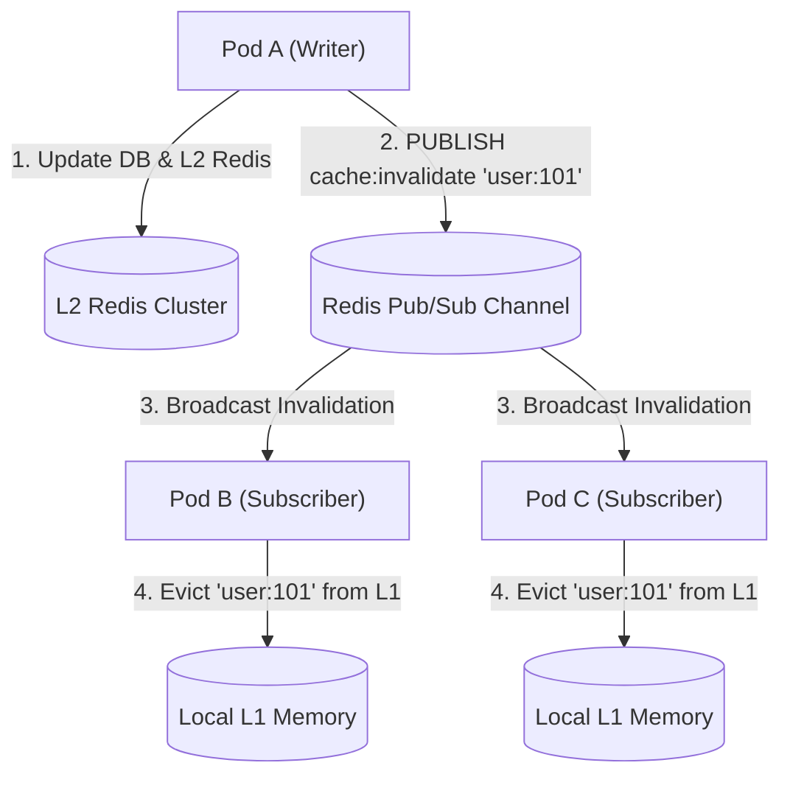

# Phase 3 Manual: Distributed Caching, High Availability & Staff/Principal Patterns

This manual covers the advanced distributed systems engineering required to operate caching tiers at petabyte scale. You will master **Multi-Tier L1/L2 Caching Coherence, Consistent Hashing (Ketama) vs Redis Cluster (16,384 Hash Slots), High Availability Failover & Split-Brain Mitigation, and the 5 Classic Production Disaster Modes (Penetration, Avalanche, Stampede, Hot Keys, Big Keys)**.

---

## Prerequisites

Ensure your Phase 0 cluster is running:
```bash
docker compose -f cache/docker-compose.yml up -d
```

---

## Day 10: Multi-Tier Caching (L1 Local + L2 Distributed) & Coherence

In hyper-scale architectures, querying a remote Redis cluster across the network (0.5ms – 2ms) is still too slow for hot-path services handling hundreds of thousands of requests per second.

**The Solution: Multi-Tier Caching**
- **L1 (Local In-Memory Cache):** Inside application process memory (Go `sync.Map`, BigCache, or Ristretto). Latency: **~50–100 nanoseconds**.
- **L2 (Remote Distributed Cache):** Shared Redis Cluster. Latency: **~1 millisecond**.
- **L3 (Primary Storage):** PostgreSQL / CockroachDB / Cassandra. Latency: **~10–50 milliseconds**.

```
[Incoming Request]
        │
        ▼
   Does L1 have it? (In-Process Memory: ~50ns)
        │
   ┌────┴────┐
  YES        NO
   │         │
Return    Does L2 have it? (Remote Redis: ~1ms)
   │         │
   │    ┌────┴────┐
   │   YES        NO
   │    │         │
   │  Backfill  Does DB have it? (PostgreSQL: ~20ms)
   │   L1         │
   │    │       Backfill L2 & L1
   │    ▼         │
   └─► Return ◄───┘
```

---

### The Cache Coherence Problem
Multi-tier caching introduces a severe distributed systems hazard: **Data Inconsistency across Application Pods**.

```
[Scenario: Stale L1 Memory Desynchronization]
1. Pod A reads User 101 -> Stores "Tier: Gold" in its local L1 cache.
2. Pod B reads User 101 -> Stores "Tier: Gold" in its local L1 cache.
3. User upgrades to "Tier: Platinum". Request routes to Pod A.
4. Pod A updates DB and invalidates L2 Redis. Pod A updates its own L1.
5. BUT Pod B still has "Tier: Gold" in its local memory!
   Result: Requests hitting Pod B see stale data for the remainder of its L1 TTL!
```

---

### Coherence Mechanism 1: Redis Pub/Sub Invalidation Bus
Whenever any pod updates data, it publishes an invalidation message to a shared Redis Pub/Sub channel:



---

### Coherence Mechanism 2: Redis 6+ Client-Side Tracking (RESP3)
Redis 6 introduced native **Client-Side Caching (Tracking Mode)**:
1. When your client reads a key (`GET user:101`), the Redis connection enables tracking.
2. Redis tracks which client connections hold which keys in memory.
3. When the key is modified by any other client, Redis automatically pushes an asynchronous invalidation message to the client over the RESP3 protocol.
4. The client's driver immediately evicts the key from its local L1 memory.

---

## Day 11: Distributed Sharding & Consistent Hashing

When cache volume exceeds a single physical server's memory capacity (e.g., storing 500GB of cache across 64GB servers), data must be partitioned.

### 1. The Modulo Sharding Disaster
The naive approach to partitioning:
$$\text{Node Index} = \text{hash}(\text{key}) \pmod N$$

#### Why Modulo Fails in Production:
If you have 4 nodes ($N=4$) and Node 3 crashes ($N=3$):
- Nearly **100% of keys remap to different nodes**!
- Instant **Cache Wipeout**: Every subsequent read misses the cache and slams the primary database at the same instant.

---

### 2. Consistent Hashing (The Ketama Algorithm)
Consistent hashing maps both **cache nodes** and **data keys** onto an abstract **32-bit Integer Ring** ($0$ to $2^{32}-1$):

```
                       Node A (Hash: 1,000,000)
                              ○
                       .             .
                  .                       .
            .                                   .
Key 1 (Hash: 2,500,000) ──► Maps to Node B!       .
        .                                           .
       .                                             .
Node C (Hash: 3,500,000)                       Node B (Hash: 2,800,000)
       ○                                             ○
         .                                         .
           .                                     .
                  .                       .
                       .             .
                              ○
```

#### The Routing Rule:
1. Hash the key onto the ring.
2. Walk **clockwise** until you encounter the first cache node.
3. Store/read the key on that node.

#### Why Consistent Hashing Scales:
- When a node is added or removed, only $\mathbf{1/N}$ **of keys are remapped** (only keys between the removed node and its predecessor). The other $(N-1)/N$ keys remain completely unaffected!

#### Virtual Nodes (V-Nodes):
If physical nodes are placed unevenly on the ring, one node might receive 80% of the traffic.
- **Solution:** Each physical node is hashed $V$ times (e.g., 256 virtual nodes per machine: `nodeA#1`, `nodeA#2`, ...).
- Guarantees near-perfect statistical uniformity across servers.

---

### 3. Redis Cluster Sharding Architecture: 16,384 Hash Slots

Redis Cluster does not use a continuous hash ring; it uses **16,384 deterministic Hash Slots**:

$$\text{Slot} = \text{CRC16}(\text{key}) \pmod{16384}$$

```
Redis Cluster (16,384 Slots distributed across 3 Masters)
┌─────────────────────────────────┬─────────────────────────────────┬─────────────────────────────────┐
│ Master 1 (Port 7000)            │ Master 2 (Port 7001)            │ Master 3 (Port 7002)            │
│ Owns Slots: 0 – 5460            │ Owns Slots: 5461 – 10922        │ Owns Slots: 10923 – 16383       │
└─────────────────────────────────┴─────────────────────────────────┴─────────────────────────────────┘
```

#### Hash Tags `{...}` for Multi-Key Operations:
In Redis, multi-key operations (transactions, MGET, Lua scripts) require all involved keys to reside on the same node.
- **Hash Tags:** Enclose the routing substring in curly braces `{}`:
  - Key 1: `{user:101}:profile`
  - Key 2: `{user:101}:orders`
  - Key 3: `{user:101}:cart`
- Redis computes CRC16 **only on the contents inside `{}`** (`user:101`). All three keys are guaranteed to map to the exact same hash slot and node!

#### Cluster Redirection Protocols:
- **`MOVED <slot> <ip:port>`:** Permanent redirection. The slot has moved; client updates its internal slot-to-node routing table.
- **`ASK <slot> <ip:port>`:** Temporary redirection. Key migration is currently in progress; client sends `ASKING` then repeats the query to the target node without altering its routing table.

---

## Day 12: High Availability, Sentinel & Replication Failover

### 1. Redis Replication Protocol (`PSYNC`)
Redis master-replica synchronization operates in two modes:

#### Full Resynchronization:
1. Master initiates background snapshotting (`BGSAVE`), creating an RDB file on disk.
2. Master streams the RDB file over the network to the replica.
3. Replica wipes its existing memory and loads the RDB file.
4. Master streams all buffered write commands that occurred during the transfer.

#### Partial Resynchronization (Fast Recovery):
If a replica temporarily disconnects for 5 seconds due to a network blip:
- Master maintains an in-memory circular ring buffer: **Replication Backlog Buffer** (`repl-backlog-size`).
- Upon reconnection, replica sends `PSYNC <master_replid> <offset>`.
- If the replica's offset is still within the master's backlog ring buffer, the master simply streams the missing bytes. **Zero disk snapshotting required!**

---

### 2. Sentinel Split-Brain & Dual-Master Disaster Prevention

In a network partition, a master can be cut off from Sentinels while still receiving client writes, leading to split-brain data loss when the network heals:

```
[Network Partition Split-Brain]
Zone A (Old Master isolated with Client A)  |  Zone B (Sentinels + Replicas)
[redis-master] ◄── Writes continue!        |  Sentinels detect missing master
                                           |  Promote replica -> [NEW MASTER]
                                           |  Client B writes to New Master
                                           |
When partition heals:
Zone A master is demoted to replica -> Wipes its memory to sync with Zone B!
💥 ALL WRITES MADE TO ZONE A MASTER ARE PERMANENTLY DESTROYED!
```

#### The Production Defense:
Configure Redis Master to reject writes if it loses quorum with replicas:
```redis
# Reject writes if fewer than 1 replica acknowledges within 10 seconds:
min-replicas-to-write 1
min-replicas-max-lag 10
```
If an isolated master cannot reach at least 1 healthy replica, it immediately returns `(error) NOREPLICAS Not enough good replicas to write`. **Data loss is mathematically prevented!**

---

## Day 13: The 5 Classic Production Disaster Modes (Staff/Principal Level)

```
┌────────────────────────────────────────────────────────────────────────┐
│                   THE 5 CLASSIC CACHE DISASTER MODES                   │
├────────────────────┬────────────────────┬──────────────────────────────┤
│ 1. PENETRATION     │ 2. AVALANCHE       │ 3. STAMPEDE (THUNDERING HERD)│
│ Queries for non-   │ Millions of keys   │ Single hot key expires;      │
│ existent keys bypass│ expire simultaneously; thousands of queries hit │
│ cache and hit DB   │ DB crashes         │ DB at same millisecond       │
├────────────────────┼────────────────────┼──────────────────────────────┤
│ 4. HOT KEY         │ 5. BIG KEY                                        │
│ Single key exceeds │ Giant collection (500k items) blocks single-     │
│ single node network│ threaded Redis execution during reading/deletion │
└────────────────────┴───────────────────────────────────────────────────┘
```

---

### Disaster 1: Cache Penetration
- **The Problem:** Malicious attackers or buggy bots query for non-existent IDs (e.g., `GET /users/invalid-uuid-99999`).
  - Cache misses every time because the key doesn't exist.
  - Every request bypasses the cache completely and queries the database.
  - The database is overwhelmed by queries for data that never existed.

#### Mitigation A: Bloom Filters at Gateway
A **Bloom Filter** is a space-efficient probabilistic data structure that guarantees:
- *"The element is definitely not in the set"* (Zero false negatives).
- *"The element might be in the set"* (Small configurable false positive rate, e.g. 1%).

```
Request for ID ──► [Bloom Filter Check]
                          │
          ┌───────────────┴───────────────┐
          ▼                               ▼
    [Definitely NOT in DB]          [Might exist]
          │                               │
    Immediate 404!               Check Redis Cache -> Check DB
    (Zero DB overhead!)
```

#### Mitigation B: Null-Object Caching with Short TTL
If a DB query returns `NotFound`, store a sentinel null value in Redis with a short expiration:
```go
// Store null sentinel with 30-second TTL
rdb.Set(ctx, "user:invalid-999", "NULL_SENTINEL", 30*time.Second)
```

---

### Disaster 2: Cache Avalanche
- **The Problem:** A batch job or startup script seeds 500,000 catalog items with a fixed `TTL = 3600` (1 hour). Exactly 60 minutes later, all 500,000 keys expire at the **exact same second**.
  - Cache hit ratio drops from 99% to 0%.
  - Millions of incoming requests hit the database simultaneously.

#### Mitigation: TTL Jitter (Randomization)
Always add randomized entropy to expiration times:

$$\text{Final TTL} = \text{Base TTL} + \text{rand}(0, \text{Jitter})$$

```go
// Base TTL 1 hour (3600s) + random jitter between 0 and 600s
jitter := time.Duration(rand.Intn(600)) * time.Second
ttl := 1*time.Hour + jitter
rdb.Set(ctx, key, payload, ttl)
```
Expirations are smoothed into a gentle slope, eliminating the spike.

---

### Disaster 3: The Hot Key Problem
- **The Problem:** A single key (e.g., a viral product, a breaking news banner) receives 500,000 requests/sec.
  - Even in a 50-node Redis Cluster, **one key belongs to only one hash slot on one node**.
  - That specific Redis node's CPU hits 100%, and its network interface controller (NIC) saturates, dropping connections.

#### Mitigation A: Key Salting / Partitioning
Replicate the hot key across $N$ shards by appending a random suffix:
```go
// When writing the hot key:
for i := 0; i < 10; i++ {
    rdb.Set(ctx, fmt.Sprintf("hot_item_99#%d", i), payload, ttl)
}

// When reading: randomly choose a salt index
salt := rand.Intn(10)
val := rdb.Get(ctx, fmt.Sprintf("hot_item_99#%d", salt))
```
Traffic is evenly distributed across 10 independent Redis master nodes!

#### Mitigation B: Dynamic L1 In-Memory Promotion
When application pods detect a key exceeding a threshold (e.g. >1,000 reads/sec), promote the key into local in-process RAM (L1) for 10 seconds, eliminating 100% of network requests to Redis.

---

### Disaster 4: The Big Key Problem
- **The Problem:** An engineer stores a Hash or Set with 500,000 elements under a single key.
  - Running `HGETALL` or `SMEMBERS` transfers 50MB across the wire.
  - Because Redis is single-threaded, **all other client commands are blocked for 3 to 10 seconds** while Redis serializes this massive key!
  - Running `DEL big_key` blocks the thread while the memory allocator frees memory chunks.

#### Mitigation A: Asynchronous Deletion (`UNLINK`)
Never call `DEL` on large structures. Use `UNLINK`:
```redis
# ❌ BLOCKS event loop for seconds:
DEL big_collection_key

# ✅ NON-BLOCKING: Reclaims key from keyspace immediately,
# delegates memory deallocation to a background worker thread!
UNLINK big_collection_key
```

#### Mitigation B: Iterative Scanning (`HSCAN`, `SSCAN`)
Never use `HGETALL` or `KEYS *`. Stream keys in chunks of 100 using cursor-based scanning:
```redis
HSCAN my_large_hash 0 COUNT 100
```

---

### Disaster 5: Memory Fragmentation
- **The Problem:** Heavy write/update/delete workloads leave physical memory fragmented.
  - `used_memory`: 10 GB (actual data).
  - `used_memory_rss`: 22 GB (memory requested from the OS kernel).
  - `mem_fragmentation_ratio`: $\frac{22}{10} = 2.2$! The server runs out of RAM even though Redis only stores 10GB of data.

#### Mitigation: Active Memory Defragmentation
Enable Redis's native defragmenter in `redis.conf`:
```redis
activedefrag yes
active-defrag-ignore-bytes 100mb
active-defrag-threshold-lower 10   # Start defrag when fragmentation > 10%
active-defrag-threshold-upper 30   # Max aggression when fragmentation > 30%
active-defrag-cycle-min 5          # Min CPU percentage to devote to defrag
active-defrag-cycle-max 50         # Max CPU percentage to devote to defrag
```

---

## Day 14: Observability, Capacity Sizing & Production SLA Alerts

### 1. Working Set Sizing Formula
To size a caching cluster accurately before deployment:

$$\text{Total RAM} = \left( N \times (\text{KeySize} + \text{ValSize} + 64\text{B Metadata}) \right) \times 1.25 (\text{Jemalloc Overhead}) \times 1.3 (\text{Copy-on-Write Buffer})$$

Where:
- $N$: Projected peak number of active keys.
- $64\text{B}$: `redisObject` header + dict entry pointers.
- $1.25$: Jemalloc binning padding.
- $1.3$: 30% headroom for Linux Copy-on-Write (CoW) memory during background snapshotting (`BGSAVE`) and replication buffers.

---

### 2. Core Prometheus Alerting Thresholds

| Metric | Alert Condition | Root Cause & Action |
| :--- | :--- | :--- |
| **Cache Hit Ratio** | `< 85%` for 5 min | Cache penetration, stampede, or misconfigured TTLs |
| **Eviction Rate** | `rate(evicted_keys[1m]) > 100` | Working set size exceeds `maxmemory`; increase cluster RAM |
| **Memory Fragmentation** | `mem_fragmentation_ratio > 1.5` | Severe memory fragmentation; enable `activedefrag` |
| **Connected Clients** | `> 80% of maxclients` | Connection pool leak in application code |
| **Replication Lag** | `master_repl_offset - slave_offset > 50MB` | Network saturation or slow disk I/O on replica |
| **Rejected Connections**| `> 0` | Redis reached `maxclients` limit |

---

## Phase 3 Mastery & Architectural Design Checklist

Verify your mastery of Phase 3 using the questions below:

- [ ] **Q: Why does Consistent Hashing re-map only $1/N$ of keys when a node fails, whereas Modulo re-maps nearly 100%?**
  - *A:* In consistent hashing, nodes and keys are arranged on a ring. Removing a node only shifts keys that previously landed on that node to the next clockwise neighbor; all other segments of the ring remain identical. In modulo hashing, changing $N$ alters the remainder $\text{hash}(k) \pmod N$ for almost every number.

- [ ] **Q: What is a Redis Hash Slot and how do Hash Tags work?**
  - *A:* Redis Cluster partitions the keyspace into 16,384 slots ($\text{CRC16}(\text{key}) \pmod{16384}$). Hash tags `{...}` force Redis to compute the CRC16 hash only on the text inside the braces, ensuring multi-key records sharing the tag map to the exact same node.

- [ ] **Q: What is the difference between `UNLINK` and `DEL`?**
  - *A:* `DEL` synchronously reclaims memory on the main thread, blocking all other commands. `UNLINK` disassociates the key from the keyspace in $O(1)$ time and delegates the memory freeing to a background thread.

- [ ] **Q: How does a Bloom Filter prevent Cache Penetration?**
  - *A:* It sits in front of the cache and checks whether an ID could possibly exist in the database. If the Bloom filter returns false, the request is rejected immediately with a 404, preventing malicious or invalid keys from touching the database.

- [ ] **Q: What configuration parameters prevent Redis Sentinel split-brain data loss?**
  - *A:* `min-replicas-to-write 1` and `min-replicas-max-lag 10`. If an isolated master loses connectivity with its replicas during a network partition, it refuses write commands, preventing writes to a dead branch.
