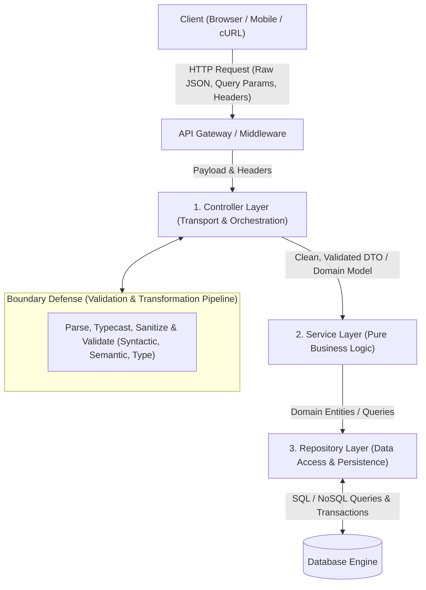
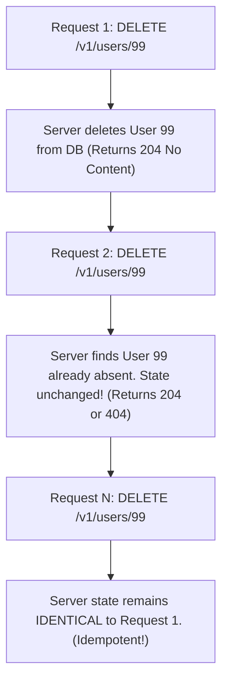
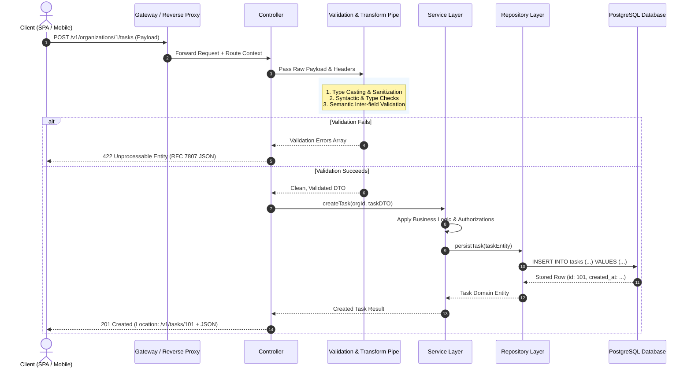

# REST API Design & Validation Pipelines: Architecture, Standards & Engineering Guide

> **Core Axioms:**
> 1. **An API is a binding public contract.** Once published, changing it breaks clients. Design with rigor, consistency, and future-proofing from day one.
> 2. **Never trust client input.** Frontend validation is for **User Experience (UX)**; backend validation is for **Security and Data Integrity**. The boundary between external networks and your domain logic must be guarded by strict validation and transformation pipelines.

---

## Table of Contents

1. [Backend Architecture Layers](#1-backend-architecture-layers)
2. [API Evolution & Web Architecture](#2-api-evolution--web-architecture)
3. [REST Architectural Constraints](#3-rest-architectural-constraints)
4. [URL & Routing Standards](#4-url--routing-standards)
5. [HTTP Methods, Semantics & Idempotency](#5-http-methods-semantics--idempotency)
6. [API Development Lifecycle Workflow](#6-api-development-lifecycle-workflow)
7. [Handling Data Collections: Pagination, Filtering & Sorting](#7-handling-data-collections-pagination-filtering--sorting)
8. [Validation & Transformation Pipelines](#8-validation--transformation-pipelines)
   - 8.1 [Purpose of Validation & Transformation](#81-purpose-of-validation--transformation)
   - 8.2 [The Three Types of Validation](#82-the-three-types-of-validation)
   - 8.3 [Data Transformation & Sanitization](#83-data-transformation--sanitization)
   - 8.4 [Complex & Inter-Field Validations](#84-complex--inter-field-validations)
   - 8.5 [Frontend vs. Backend Validation](#85-frontend-vs-backend-validation)
9. [Developer Experience (DX) & Production Standards](#9-developer-experience-dx--production-standards)
10. [Architecture Flowcharts & Master Cheat Sheet](#10-architecture-flowcharts--master-cheat-sheet)

---

## 1. Backend Architecture Layers

A scalable backend cleanly decouples transport concerns from business workflows and persistence mechanisms. Modern production systems structure their codebase into three primary tiers: the **Controller Layer**, the **Service Layer**, and the **Repository Layer**.



### 1.1 The Controller Layer (Transport Adapter)
- **Primary Responsibility:** Handles incoming HTTP/RPC transport details. It acts as the bridge between network protocols and your application's domain logic.
- **Key Duties:**
  - Extracts parameters from request paths, query strings, headers, and bodies.
  - Invokes the **Validation & Transformation Pipeline** before delegating to services.
  - Maps domain responses to appropriate HTTP status codes (e.g., `200 OK`, `201 Created`, `204 No Content`).
  - Serializes outgoing data structures into standard JSON envelopes.
- **What it must NOT do:** Never execute SQL queries, calculate domain algorithms, evaluate business rules, or interact directly with the database.

### 1.2 The Service Layer (Domain Engine)
- **Primary Responsibility:** Encapsulates pure business logic and operational orchestration.
- **Key Duties:**
  - Executes core business rules (e.g., calculating checkout taxes, charging Stripe, verifying account credit limits).
  - Orchestrates multi-step workflows across multiple repositories or external integrations.
  - Manages database transaction boundaries (Commit / Rollback).
- **Independence:** The service layer is completely protocol-agnostic. It does not know whether a request originated from an HTTP REST call, a gRPC service, a Kafka message consumer, or a CLI script.

### 1.3 The Repository Layer (Persistence Abstraction)
- **Primary Responsibility:** Mediates between domain services and physical database engines (PostgreSQL, MySQL, MongoDB).
- **Key Duties:**
  - Executes database reads, writes, joins, updates, and indexing optimizations.
  - Hides ORM or raw SQL complexities behind predictable interface methods (e.g., `findById(id)`, `save(user)`, `listByOrganization(orgId, filter)`).
  - Shields the application layer from changes to database vendors or schema migrations.

---

## 2. API Evolution & Web Architecture

To design clean, future-proof interfaces, an engineer must understand why the web evolved the way it did: from static hypertext documents to distributed, client-heavy applications communicating via REST.

```
1990: Web Foundation (Tim Berners-Lee) ──► Multi-Page Applications (MPAs) ──► Single-Page Applications (SPAs)
[URI, HTTP, HTML, Server, Browser, WYSIWYG]   [Server-rendered HTML / Refresh]   [Client-heavy JS / JSON APIs]
```

### 2.1 Historical Context (1990)
In 1990, **Tim Berners-Lee** invented the World Wide Web at CERN to solve scientific data-sharing challenges. He established the four fundamental pillars that remain the foundation of the modern internet:
1. **URI (Uniform Resource Identifier):** A universal addressing system to uniquely identify any document or resource globally.
2. **HTTP (Hypertext Transfer Protocol):** A stateless, text-based client-server protocol to request and transmit documents.
3. **HTML (Hypertext Markup Language):** A formatting language allowing documents to embed links to other URIs.
4. **Web Servers & Web Browsers:** Software to serve and render hypermedia documents (including early WYSIWYG editors like the original *WorldWideWeb* browser).

### 2.2 Paradigm Shift: Multi-Page Apps (MPAs) to Single-Page Apps (SPAs)

| Dimension | Multi-Page Applications (Traditional MPAs) | Single-Page Applications (Modern SPAs) |
| :--- | :--- | :--- |
| **Rendering Model** | Server-side rendering (SSR). The server builds full HTML pages on every navigation. | Client-side rendering (CSR). Browser downloads HTML/CSS/JS bundle on first visit. |
| **Network Payload** | Full HTML document + CSS + assets on **every single click**. | Minimal raw **JSON payloads** containing only updated data. |
| **Routing** | Browser requests new URLs directly from the server. Full page refresh occurs. | Client-side JavaScript router updates the DOM without full reloads. |
| **Server Responsibility** | Coupled: UI generation + business logic + persistence. | Decoupled: Pure API server supplying data endpoints. |
| **Bandwidth & Latency** | High redundant bandwidth; slower perceived page transitions. | Fast transitions after initial bundle load; network traffic is lightweight JSON. |

As SPAs (built with React, Vue, Angular, Svelte) and native mobile apps (iOS/Android) became the standard, servers shifted from rendering views to providing clean, uniform programmatic endpoints. This transition accelerated the adoption of **REST**.

---

## 3. REST Architectural Constraints

In 2000, **Dr. Roy Fielding** introduced **Representational State Transfer (REST)** in his landmark doctoral dissertation, *"Architectural Styles and the Design of Network-based Software Architectures"*, to address web-scale distributed computing challenges.

### 3.1 Deconstructing the Name: REST

```
┌────────────────────────────────────────────────────────────────────────┐
│                    REPRESENTATIONAL STATE TRANSFER                     │
├───────────────────┬─────────────────────────┬──────────────────────────┤
│ REPRESENTATIONAL  │ STATE                   │ TRANSFER                 │
│ Data exchanged as │ The current condition,  │ Moving representations   │
│ representations   │ attributes, or snapshot │ between client and server│
│ (JSON, XML, HTML) │ of a specific resource. │ across stateless requests│
└───────────────────┴─────────────────────────┴──────────────────────────┘
```

### 3.2 The Six Architectural Constraints of REST

To be truly "RESTful", a system must adhere to six architectural constraints:

#### 1. Client-Server Architecture
- **Concept:** Strict separation of user interface concerns from data storage and business logic concerns.
- **Benefit:** Allows clients (web browsers, mobile apps, IoT devices) to evolve independently of backend database engines and server infrastructure.

#### 2. Statelessness
- **Concept:** The server must not store any client context or session state between requests. Every request from client to server must contain all the information necessary to understand and process the request (including authentication credentials, query parameters, and resource payloads).
- **Benefit:** Eliminates server-side session memory synchronization, enabling horizontal autoscaling behind load balancers with zero session sticky-routing requirements.

#### 3. Cacheability
- **Concept:** Every network response must explicitly declare whether it can be cached by the client or intermediary proxies, and for how long (via HTTP headers such as `Cache-Control`, `ETag`, `Last-Modified`, and `Age`).
- **Benefit:** Drastically reduces client-perceived latency and decreases server load by allowing CDNs and client caches to fulfill identical requests.

#### 4. Layered System
- **Concept:** A client cannot tell whether it is connected directly to the end application server or to an intermediary component (e.g., a reverse proxy, TLS terminator, rate limiter, caching proxy, or load balancer).
- **Benefit:** Allows backend engineers to introduce security firewalls, caching layers, and load distribution without modifying client application code.

#### 5. Uniform Interface
- **Concept:** The most critical constraint distinguishing REST from other RPC styles. It mandates a standardized communication contract consisting of four sub-requirements:
  1. **Resource Identification in Requests:** Individual resources are identified using standardized URIs (e.g., `/v1/users/42`).
  2. **Manipulation of Resources through Representations:** When a client holds a representation of a resource (such as JSON), it possesses sufficient information to modify or delete the resource on the server (given adequate permissions).
  3. **Self-Descriptive Messages:** Each message includes enough metadata for the receiver to parse it (e.g., `Content-Type: application/json`).
  4. **HATEOAS (Hypermedia As The Engine Of Application State):** The server supplies dynamic hyperlinks inside responses to inform the client of actions it can take next from its current state.

#### 6. Code on Demand (Optional)
- **Concept:** Servers can temporarily extend or customize client functionality by transferring executable code (e.g., JavaScript scripts, WebAssembly applets).
- **Benefit:** Reduces pre-installed client software requirements while allowing dynamic UI enhancements.

---

## 4. URL & Routing Standards

A clean REST API treats URLs as **addresses of resources**, not commands or function calls.

### 4.1 Anatomy of a RESTful URL

```
  https://api.example.com/v1/organizations/org-89/projects/proj-12/tasks?limit=10&page=2#summary
  ──┬──   ───────┬─────── ─┬ ───────────────┬───────────────────────── ──────────┬──────── ───┬───
    │            │         │                │                                    │            │
  Scheme      Domain    Version     Hierarchical Path (Plural Nouns)        Query Params   Fragment
```

| Component | Example | Architectural Rule & Purpose |
| :--- | :--- | :--- |
| **Scheme** | `https` | Always enforce `https` in production to encrypt tokens, headers, and payloads in transit. |
| **Domain** | `api.example.com` | Use a dedicated subdomain (`api.`) or path prefix (`example.com/api`) to decouple API routing from static frontends. |
| **Versioning** | `/v1` | Mandate major version prefixes in the path. Protects clients from breaking contract changes. |
| **Resources** | `/organizations/.../tasks` | Always use **plural nouns**. Never use verbs. Represents collections of entities. |
| **Resource ID / Slug** | `org-89`, `proj-12` | Uniquely identifies a single item within the preceding collection. Use UUIDs, integer IDs, or hyphenated slugs. |
| **Query Parameters** | `?limit=10&page=2` | Used strictly for non-hierarchical operations: **filtering, sorting, searching, and pagination**. |
| **Fragment** | `#summary` | Client-side anchor. **Never sent over the wire** by HTTP user agents to the backend server. |

### 4.2 URL Formatting & Casing Standards

> [!IMPORTANT]
> - **Use lowercase letters exclusively:** URLs are case-sensitive according to the POSIX and RFC standards (`/Books` vs `/books` are technically different paths on Linux file systems). Lowercase avoids routing mismatches.
> - **No spaces or underscores (`_`):** Underscores can be obscured by browser link underlines. Use **hyphens (kebab-case)** for slugs and multi-word resource names.
> - **Never include verbs in URIs:** The HTTP method specifies the action. The URI specifies the noun.

```
❌ BAD (RPC style, verbs, underscores, singular, camelCase):
   GET  /api/getUserDetails?id=12
   POST /api/create_new_book
   POST /api/v1/deleteTask/45
   GET  /api/v1/userProfile/123

✅ GOOD (RESTful, plural nouns, kebab-case, HTTP methods convey action):
   GET    /v1/users/12
   POST   /v1/books
   DELETE /v1/tasks/45
   GET    /v1/user-profiles/123
```

### 4.3 Modeling Resource Hierarchies & Sub-Resources

Hierarchical paths should represent natural ownership. However, avoid deep nesting beyond two levels, as it makes URLs unwieldy.

```
Natural Parent-Child Ownership (Max 2 levels deep):
GET    /v1/organizations/{orgId}/projects            -> List projects owned by org
POST   /v1/organizations/{orgId}/projects            -> Create project under org
GET    /v1/organizations/{orgId}/projects/{projId}   -> Fetch specific project

Avoid excessive nesting:
❌ AVOID: GET /v1/organizations/1/projects/5/tasks/42/comments/9
✅ BETTER: Use top-level endpoints for deeply nested child resources once identity is unique:
          GET /v1/tasks/42/comments
          GET /v1/comments/9
```

---

## 5. HTTP Methods, Semantics & Idempotency

Understanding **Safety** and **Idempotency** is the hallmark of professional backend engineering.

### 5.1 The Mathematical Concept of Idempotency
In computer science and mathematics, an operation is **idempotent** if applying it multiple times produces the **exact same system state** as applying it once:

$$f(f(x)) = f(x)$$

- In HTTP APIs: An HTTP method is idempotent if making $N > 1$ identical requests with that method has the identical effect on server storage as making a single request.
- **Safety:** An operation is "safe" if it is **read-only** and does not alter server state at all (e.g., `GET`, `HEAD`, `OPTIONS`). All safe methods are inherently idempotent, but not all idempotent methods are safe.



### 5.2 Deep Dive into Core HTTP Methods

#### `GET` (Safe & Idempotent)
- **Semantics:** Retrieves a representation of a resource without mutating server state.
- **Payload:** Must not require a request body.
- **Responses:** `200 OK` (with payload), `404 Not Found`.

#### `POST` (Unsafe & NON-Idempotent)
- **Semantics:** Creates a subordinate resource under a collection, or triggers an arbitrary non-CRUD execution (e.g., `/checkout`, `/calculate-tax`).
- **Idempotency:** **NON-IDEMPOTENT**. Sending the same `POST /v1/orders` request three times creates **three distinct orders** and charges the customer three times (unless explicit idempotency keys are used).
- **Responses:** `201 Created` (with `Location` header pointing to new resource), `202 Accepted` (async processing).

#### `PUT` (Unsafe & Idempotent)
- **Semantics:** **Full resource replacement**. The client sends a complete representation to be stored at the specified URI. If the resource exists, it is completely overwritten. If it does not exist, it may be created at that URI.
- **Idempotency:** **IDEMPOTENT**. Overwriting the exact same object representation 5 times results in the same final record in the database.
- **Responses:** `200 OK` or `204 No Content`.

#### `PATCH` (Unsafe & Idempotent in Standard REST)
- **Semantics:** **Partial update**. Modifies only the specific fields provided in the payload, leaving other fields intact.
- **Idempotency:** In standard entity field replacement (`{"name": "Alice"}`), it is **idempotent**. (Note: If an operation performs relative mutations like `{"increment": 1}`, it becomes non-idempotent).
- **Responses:** `200 OK` (returns updated object) or `204 No Content`.

#### `DELETE` (Unsafe & Idempotent)
- **Semantics:** Removes the resource identified by the URI.
- **Idempotency:** **IDEMPOTENT**. Once deleted, the resource remains deleted regardless of how many times the client re-sends the request.
- **Responses:** `200 OK` (with deleted summary) or `204 No Content` (recommended). Subsequent calls can return `204 No Content` or `404 Not Found`.

### 5.3 Method Comparison Matrix

| HTTP Method | Safe? (Read-Only) | Idempotent? $f(f(x))=f(x)$ | Primary Purpose | Standard Success Status Code |
| :---: | :---: | :---: | :--- | :---: |
| **`GET`** | **YES** | **YES** | Read resource representation | `200 OK` |
| **`POST`** | NO | **NO** | Create subordinate resource / Action | `201 Created` / `202 Accepted` |
| **`PUT`** | NO | **YES** | Full replacement of target resource | `200 OK` / `204 No Content` |
| **`PATCH`**| NO | **YES*** | Partial update of specific fields | `200 OK` / `204 No Content` |
| **`DELETE`**| NO | **YES** | Remove target resource | `204 No Content` / `200 OK` |

---

## 6. API Development Lifecycle Workflow

A professional engineering team does not jump directly into writing database migrations or coding controllers. Standardized APIs follow a systematic 4-stage lifecycle:

```
┌─────────────────────────┐     ┌─────────────────────────┐     ┌─────────────────────────┐     ┌─────────────────────────┐
│ 1. REQUIREMENT ANALYSIS │ ──► │ 2. DATABASE SCHEMA      │ ──► │ 3. INTERFACE CONTRACT   │ ──► │ 4. IMPLEMENTATION &     │
│ Extract Domain Nouns    │     │ Define Relational Tables│     │ API-First OpenAPI/Specs │     │ CRUD Operations Matrix  │
│ from Figma / User Stories│     │ & Foreign Key Bounds    │     │ in Postman / Insomnia   │     │ Controller, Svc, Repo   │
└─────────────────────────┘     └─────────────────────────┘     └─────────────────────────┘     └─────────────────────────┘
```

### Stage 1: Requirement Analysis (Mining Domain Nouns)
- Analyze design mockups, wireframes (Figma), and user stories.
- **Extract the Nouns (Entities):** Nouns represent your database tables and REST resources.
  - *Example Figma Screen:* A project management dashboard displaying a workspace, projects inside it, tasks assigned to users, and comment threads.
  - *Identified Nouns:* `Organization`, `Project`, `Task`, `User`, `Comment`.

### Stage 2: Database Schema Design
- Model entities, primary keys, foreign key constraints, indexes, and relationship cardinality:
  - `Organization` (1) ── (N) `Project`
  - `Project` (1) ── (N) `Task`
  - `User` (1) ── (N) `Task` (Assignee)
  - `Task` (1) ── (N) `Comment`

### Stage 3: Interface Design (API-First / Contract-First)
- Before writing backend code, draft the API contract using **OpenAPI (Swagger)** or API client collections (**Postman / Insomnia**).
- **Benefits of API-First:**
  - Frontend and backend teams can agree on request/response shapes in advance.
  - Frontend developers can run mock servers against the contract and build UIs in parallel with backend development.
  - Validates edge cases (missing attributes, nullable fields, pagination envelopes) before database migrations are locked in.

### Stage 4: Operations & Route Matrix
Map every resource to its necessary CRUD operations, HTTP methods, and status codes:

```text
Resource: Task (/v1/projects/{projectId}/tasks)
├── CREATE: POST   /v1/projects/{projectId}/tasks       -> 201 Created
├── LIST:   GET    /v1/projects/{projectId}/tasks       -> 200 OK (Paginated)
├── GET:    GET    /v1/tasks/{taskId}                   -> 200 OK
├── UPDATE: PATCH  /v1/tasks/{taskId}                   -> 200 OK
└── DELETE: DELETE /v1/tasks/{taskId}                   -> 204 No Content
```

---

## 7. Handling Data Collections: Pagination, Filtering & Sorting

Endpoints returning lists of records must never return unbounded database tables. Unbounded queries will exhaust database memory, spike CPU utilization, saturate network bandwidth, and crash client browsers.

### 7.1 Pagination Architecture

#### Strategy A: Offset-Based Pagination (Page & Limit)
- **Query Params:** `?page=2&limit=20` (or `?offset=20&limit=20`)
- **SQL Implementation:** `SELECT * FROM tasks WHERE project_id = 5 ORDER BY created_at DESC LIMIT 20 OFFSET 20;`
- **Pros:** Intuitive for users; enables direct navigation to specific page numbers ("jump to page 5").
- **Cons:**
  - **Performance degradation on large datasets:** `OFFSET 1000000` forces the database engine to scan 1,000,020 rows off disk before discarding the first 1,000,000.
  - **Offset drift:** If an item is inserted while a user is paginating, subsequent pages may show duplicate items.

#### Strategy B: Keyset / Cursor-Based Pagination
- **Query Params:** `?cursor=eyJpZCI6MTAxfQ==&limit=20`
- **SQL Implementation:** `SELECT * FROM tasks WHERE project_id = 5 AND id < 101 ORDER BY id DESC LIMIT 20;`
- **Pros:** Highly performant ($O(1)$ index lookup regardless of depth); completely immune to offset drift. Ideal for infinite scroll feeds (e.g., Twitter, Instagram).
- **Cons:** Cannot jump directly to arbitrary page numbers.

### 7.2 Standard Response Envelope & Metadata
Always return structured metadata alongside the data array so clients can build pagination controls cleanly:

```json
{
  "data": [
    {
      "id": "task_101",
      "title": "Configure Kafka KRaft cluster",
      "status": "in_progress",
      "priority": "high",
      "createdAt": "2026-11-01T10:00:00Z"
    }
  ],
  "pagination": {
    "totalCount": 142,
    "currentPage": 2,
    "totalPages": 8,
    "limit": 20,
    "hasNext": true,
    "hasPrevious": true
  }
}
```

### 7.3 Filtering Architecture
Allow clients to narrow down collection results using explicit query parameters:

```
Filter by field:     GET /v1/tasks?status=in_progress
Filter by multiple:  GET /v1/tasks?status=in_progress&priority=high
Filter by range:     GET /v1/tasks?created_after=2026-01-01&created_before=2026-11-01
Filter by tags:      GET /v1/tasks?tags=backend,kafka
```

### 7.4 Sorting Architecture
Provide predictable sorting with sane default ordering (typically newest first):

```
Syntax Style 1 (Field + Direction):  GET /v1/tasks?sort=createdAt:desc
Syntax Style 2 (Prefix Notation):    GET /v1/tasks?sort=-createdAt,+priority
Multi-column sorting:                GET /v1/tasks?sort=priority:desc,dueDate:asc
```

---

## 8. Validation & Transformation Pipelines

The **Validation and Transformation Pipeline** is the gatekeeper of your backend. It converts untrusted, string-based client inputs into clean, strongly typed, verified data models before domain logic is touched.

### 8.1 Purpose of Validation & Transformation

```
Untrusted HTTP Request (cURL, Browser, Malicious Script)
                 │
                 ▼
┌────────────────────────────────────────────────────────┐
│     VALIDATION & TRANSFORMATION PIPELINE (GATEWAY)     │
│                                                        │
│  1. Parse JSON / Query Strings                         │
│  2. Type Checking (Match schema data types)            │
│  3. Type Casting (Convert "10" -> 10, "true" -> true)  │
│  4. Syntactic Validation (Regex, RFC emails, UUIDs)    │
│  5. Semantic Validation (Logical integrity, date order)│
│  6. Sanitization (Trim spaces, escape XSS, whitelist)  │
└──────────────────────────┬─────────────────────────────┘
                           │
             ┌─────────────┴─────────────┐
             ▼                           ▼
        [Passes All]                [Fails Any]
             │                           │
  Clean DTO forwarded to      Fail-Fast: Immediate 400/422
  Service & Business Logic    RFC 7807 Detailed Error JSON
```

- **Fail-Fast Principle:** Reject invalid requests at the earliest possible boundary. Do not allocate database connection pools, invoke external payment gateways, or run expensive computations for malformed requests.
- **Defense in Depth:** Protect internal persistence tiers from corrupted data structures, SQL injection vectors, and prototype pollution.
- **Contract Enforcement:** Guarantee that the Service Layer receives predictable, strongly typed objects.

---

### 8.2 The Three Types of Validation

Robust pipelines classify validation checks into three distinct levels:

```
┌──────────────────────────────────────────────────────────────────────────┐
│                           LEVELS OF VALIDATION                           │
├────────────────────┬─────────────────────────────┬───────────────────────┤
│ 1. TYPE VALIDATION │ 2. SYNTACTIC VALIDATION     │ 3. SEMANTIC VALIDATION│
│ Verifies primitive │ Verifies format, structure, │ Verifies logical      │
│ & object data types│ regex, and character bounds │ meaning & constraints │
└────────────────────┴─────────────────────────────┴───────────────────────┘
```

#### 1. Type Validation
- **What it checks:** Does the incoming JSON value match the expected primitive or composite type?
- **Examples:**
  - `age` must be an integer, not a string or array (`{"age": "twenty"}` $\rightarrow$ ❌ REJECT).
  - `tags` must be an array of strings, not a single string (`{"tags": "backend"}` $\rightarrow$ ❌ REJECT).
  - `isSubscribed` must be a boolean (`true` / `false`), not a number (`1` / `0`).

#### 2. Syntactic Validation
- **What it checks:** Does the string or number conform to specific structural syntax rules, character patterns, or regular expressions?
- **Examples:**
  - **Email Format:** Validated against RFC 5322 regex standards (`user@domain.com`).
  - **Date Format:** Must conform to ISO 8601 (`YYYY-MM-DDTHH:mm:ssZ`).
  - **UUID Format:** Must be a valid 36-character UUID v4 string.
  - **String Length Bounds:** Password must be between 8 and 64 characters; Username cannot exceed 30 alphanumeric characters.

#### 3. Semantic Validation
- **What it checks:** Does the data make logical sense in the real world and within your business domain?
- **Examples:**
  - `dateOfBirth` cannot be in the future (a user cannot be born tomorrow).
  - `endDate` must be greater than or equal to `startDate` on a reservation booking.
  - `discountPrice` must be strictly less than `regularPrice`.
  - An e-commerce order must contain at least one line item with a quantity $> 0$.

---

### 8.3 Data Transformation & Sanitization

Incoming HTTP input is notoriously "dirty." Clients transmit query parameters as strings, strings often include accidental leading/trailing whitespace, and input may contain malicious script tags.

#### Transformation Responsibilities:
1. **Type Casting:**
   - Query string parameters arrive over HTTP as strings: `?page=2&limit=50&active=true`.
   - The transformation layer casts these into native primitives: `page: 2` (int), `limit: 50` (int), `active: true` (boolean).
2. **Sanitization & Normalization:**
   - **Whitespace Trimming:** `"  alice@example.com  "` $\rightarrow$ `"alice@example.com"`.
   - **Case Normalization:** Email addresses are case-insensitive per RFC; normalize to lowercase (`"User@DOMAIN.Com"` $\rightarrow$ `"user@domain.com"`).
   - **Phone Number Normalization:** Standardize to international E.164 format (`"(555) 123-4567"` $\rightarrow$ `"+15551234567"`).
3. **Mass-Assignment Protection (Whitelisting):**
   - Malicious clients often attempt parameter tampering (e.g., submitting `{"isAdmin": true}` during signup).
   - The transformation pipeline must enforce **strict whitelisting**: strip out any fields not explicitly declared in the Data Transfer Object (DTO).

---

### 8.4 Complex & Inter-Field Validations

Real-world applications require validation rules that span multiple fields or depend conditionally on other fields.

#### Pattern 1: Confirmation Matching (Field Equality)
Ensuring confirmation inputs match their primary field:
- **Scenario:** User registration password verification.
- **Rule:** `passwordConfirmation === password`. If they differ, reject with a targeted validation error on `passwordConfirmation`.

#### Pattern 2: Conditional Requirements (Dependent Fields)
Requiring a field only if another field has a specific value:
- **Scenario:** Marital status and partner information.
  - If `isMarried === true` $\rightarrow$ `partner` object `{ name: string, dateOfBirth: string }` is **strictly required**.
  - If `isMarried === false` $\rightarrow$ `partner` object must be `null` or omitted.
- **Scenario:** Payment gateway processing.
  - If `paymentMethod === "credit_card"` $\rightarrow$ `cardNumber`, `cvv`, and `expiryDate` are mandatory.
  - If `paymentMethod === "paypal"` $\rightarrow$ `paypalEmail` is mandatory, and `cardNumber` must not be supplied.

#### TypeScript/Zod Implementation Example:
```typescript
import { z } from 'zod';

export const RegistrationSchema = z.object({
  email: z.string().trim().toLowerCase().email(),
  password: z.string().min(8).max(64),
  passwordConfirmation: z.string(),
  isMarried: z.boolean(),
  partner: z.object({
    fullName: z.string().min(1),
    dateOfBirth: z.string().date()
  }).optional()
})
// Rule 1: Inter-field matching
.refine((data) => data.password === data.passwordConfirmation, {
  message: "Password confirmation does not match password",
  path: ["passwordConfirmation"]
})
// Rule 2: Conditional dependency
.refine((data) => !data.isMarried || (data.isMarried && data.partner !== undefined), {
  message: "Partner details are strictly required when isMarried is true",
  path: ["partner"]
});
```

---

### 8.5 Frontend vs. Backend Validation

A foundational rule of software security: **The frontend is an untrusted environment controlled entirely by the user.**

```
[Attacker with cURL / Postman / Python script]
                 │
                 ├──► Bypasses React / Vue / HTML5 completely!
                 │
                 ▼
     [Direct HTTP Request to Backend]
                 │
                 ▼
  ┌──────────────────────────────┐
  │   BACKEND VALIDATION PIPE    │ <── MUST BE IMPENETRABLE!
  └──────────────────────────────┘
```

| Dimension | Frontend Validation | Backend Validation |
| :--- | :--- | :--- |
| **Primary Goal** | **User Experience (UX)**. Instant visual feedback, prevents unnecessary latency. | **Security, Authorization & Data Integrity**. System protection. |
| **Bypassability** | **Trivial to bypass.** Anyone can disable JavaScript, use browser DevTools, or send raw requests via cURL, Postman, or custom Python scripts. | **Impossible to bypass** without server-side vulnerabilities. Operates on the server. |
| **Performance Impact** | Fast (runs instantly in client memory without network round-trips). | Essential (consumes server CPU, but prevents massive database corruption). |
| **Scope** | Basic formatting, required field checking, visual error states. | Full Syntactic, Type, Semantic, Database Uniqueness, and Authorization checks. |
| **Engineering Rule** | **Optional / Nice-to-have**. Enhances client interaction. | **STRICTLY MANDATORY**. Never trust any incoming client bytes. |

---

## 9. Developer Experience (DX) & Production Standards

An API is not just code; it is a product consumed by other developers (both internal teams and external third parties). Superior Developer Experience (DX) drives adoption and reduces bugs.

### 9.1 Sane Defaults & Defensive Design
- Never require clients to send boilerplate parameters when logical defaults exist.
  - If a client requests `GET /v1/tasks` without pagination parameters, default to `page=1` and `limit=20`.
  - Default sort should order by `createdAt:desc`.
  - Default status filters should display active resources, not archived ones.

### 9.2 Standardized JSON Envelopes & Casing Consistency
- Pick a casing convention and stick to it across your entire API suite.
  - **JSON Payloads:** `camelCase` (standard in JavaScript/TypeScript ecosystems) or `snake_case` (standard in Python/Ruby ecosystems). **Never mix both.**
  - **Query Parameters:** Typically `snake_case` (e.g., `?created_after=...`) or `camelCase`.
  - **HTTP Headers:** Kebab-case (e.g., `X-Request-ID`, `Idempotency-Key`).

### 9.3 Machine-Readable Error Responses (RFC 7807 / RFC 9457)
Never return raw string errors like `{"error": "something went wrong"}`. Use standard RFC 7807 *Problem Details for HTTP APIs*:

```json
{
  "type": "https://api.example.com/v1/errors/validation-failed",
  "title": "Validation Failed",
  "status": 422,
  "detail": "The payload contained 2 semantic and syntactic errors.",
  "instance": "/v1/users/registration",
  "invalidParams": [
    {
      "field": "email",
      "reason": "Must be a valid RFC 5322 email address.",
      "rejectedValue": "bad_email_format"
    },
    {
      "field": "passwordConfirmation",
      "reason": "Does not match the provided password.",
      "rejectedValue": "secret123"
    }
  ]
}
```

### 9.4 Living Interactive Documentation (Swagger / OpenAPI)
- **OpenAPI 3.0+ (Swagger):** Define schema contracts directly in code using annotations or schema generators (Zod, Pydantic, Go struct tags).
- Expose an interactive UI (`/docs` or `/swagger`) allowing developers to test endpoints, inspect authentication requirements, and view example request/response payloads directly from their browser.
- **Avoid Cryptic Abbreviations:** Use descriptive field names (`organizationId` instead of `org_no`, `dateOfBirth` instead of `dob`, `phoneNumber` instead of `ph`).

---

## 10. Architecture Flowcharts & Master Cheat Sheet

### 10.1 Complete End-to-End Request Pipeline



---

### 10.2 Master REST & Validation Engineering Cheat Sheet

| Concern | Production Best Practice | Anti-Pattern to Avoid |
| :--- | :--- | :--- |
| **URI Naming** | Plural nouns: `/v1/users`, `/v1/orders` | Verbs in URIs: `/v1/getUsers`, `/v1/createOrder` |
| **URL Formatting** | Kebab-case, lowercase: `/v1/user-profiles/active` | CamelCase or underscores: `/v1/UserProfiles/my_tag` |
| **CRUD Actions** | Expressed via HTTP methods: `GET`, `POST`, `PATCH`, `DELETE` | Overloading `POST` for everything (`POST /updateUser`) |
| **Idempotency** | Ensure `GET`, `PUT`, `DELETE` are strictly idempotent | Making `DELETE` alter other unrelated resources on repeat |
| **Pagination** | Return `{ data: [...], pagination: { totalCount, ... } }` | Unbounded `SELECT *` returning 50,000 rows |
| **Validation Layer** | Execute at controller entry before business logic | Scattering manual `if (!req.body.name)` inside services |
| **Type Validation** | Strict JSON primitive checking via schema validators | Relying on JavaScript implicit type coercion (`"1" + 1`) |
| **Inter-Field Rules** | Cross-validate dependent fields (e.g. conditional partner) | Assuming fields exist independently of each other |
| **Security Stance** | Treat all client input as malicious; whitelist fields | Blindly saving `req.body` directly to database (Mass assignment) |
| **Status Codes** | Return precise codes: `201` for create, `204` for delete, `422` for validation | Returning `200 OK` with `{"error": "Failed"}` inside |
| **Documentation** | Auto-generate OpenAPI/Swagger contracts from code | Outdated static markdown docs that drift from reality |
